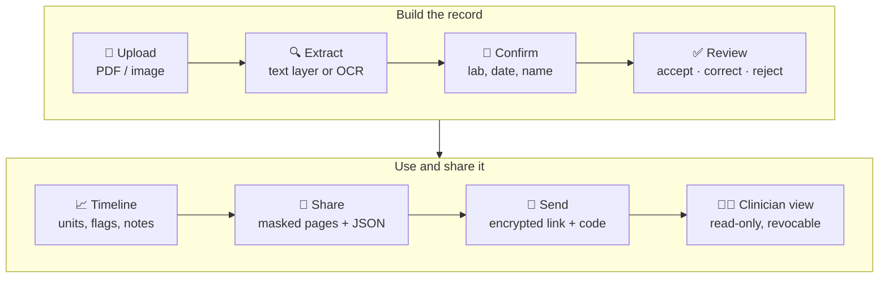

<a id="readme-top"></a>

<!-- PROJECT SHIELDS -->
<div align="center">

[![Tests][tests-shield]][tests-url]
[![Python][python-shield]][python-url]
[![Streamlit][streamlit-shield]][streamlit-url]
[![Tesseract][tesseract-shield]][tesseract-url]
[![License: MIT][license-shield]][license-url]
[![Status][status-shield]](#limitations)
[![Data][data-shield]](#limitations)

</div>

<!-- PROJECT HEADER -->
<br />
<div align="center">
  <h1 align="center">🧪 LabTrail</h1>

  <p align="center">
    <strong>A patient-controlled, source-linked history of lab results from every lab you visit.</strong>
    <br />
    Upload reports · review every value · see trends across labs · share exactly what you choose
    <br />
    <br />
    <a href="docs/implementation.md"><strong>Explore the docs »</strong></a>
    <br />
    <br />
    <a href="#usage">View Demo Walkthrough</a>
    &middot;
    <a href="https://github.com/renee127/LabTrail/issues/new?labels=bug">Report Bug</a>
    &middot;
    <a href="https://github.com/renee127/LabTrail/issues/new?labels=enhancement">Request Feature</a>
  </p>
</div>

<!-- TABLE OF CONTENTS -->
<details>
  <summary>Table of Contents</summary>
  <ol>
    <li>
      <a href="#about-the-project">About The Project</a>
      <ul>
        <li><a href="#key-features">Key Features</a></li>
        <li><a href="#built-with">Built With</a></li>
      </ul>
    </li>
    <li><a href="#how-it-works">How It Works</a></li>
    <li>
      <a href="#getting-started">Getting Started</a>
      <ul>
        <li><a href="#prerequisites">Prerequisites</a></li>
        <li><a href="#installation">Installation</a></li>
        <li><a href="#deploy-to-streamlit-community-cloud">Deploy to Streamlit Community Cloud</a></li>
      </ul>
    </li>
    <li><a href="#usage">Usage</a></li>
    <li><a href="#security-and-privacy">Security and Privacy</a></li>
    <li><a href="#validation">Validation</a></li>
    <li><a href="#project-structure">Project Structure</a></li>
    <li><a href="#roadmap">Roadmap</a></li>
    <li><a href="#limitations">Limitations</a></li>
    <li><a href="#contributing">Contributing</a></li>
    <li><a href="#license">License</a></li>
    <li><a href="#contact">Contact</a></li>
    <li><a href="#acknowledgments">Acknowledgments</a></li>
  </ol>
</details>

<!-- ABOUT THE PROJECT -->
## About The Project

People managing chronic or multi-specialty conditions rarely get lab work from a single
organization. One patient may have blood drawn at a reference lab, a hospital, and a
specialist clinic in the same year. Each releases results through its own portal, with
different layouts, units, test names, and reference ranges. A value trending across four
draws at three labs looks like four unrelated numbers, and the context behind them
(a new medication, an illness) lives only in the patient's memory.

LabTrail turns that folder of PDFs into one longitudinal record that the patient controls:

* **Every value is reviewed.** Nothing enters the record until the patient accepts or
  corrects it beside the exact region of the original report it came from.
* **Every value stays linked to its source.** Any point on the timeline opens the crop of
  the report it was read from.
* **Differences are flagged, not interpreted.** LabTrail marks when the lab, unit, or
  reference range changes between results. It never says whether a value is good or bad.
* **Sharing is scoped and revocable.** A clinician sees only the tests and dates the
  patient chose, through an encrypted link that the patient can revoke.

> [!NOTE]
> LabTrail is an academic prototype that runs locally on **synthetic data**. It organizes
> results; it does not diagnose or give medical advice.

<p align="right">(<a href="#readme-top">back to top</a>)</p>

### Key Features

| Area | What the prototype does |
| :--- | :--- |
| 📄 **Import** | PDF, PNG, and JPEG uploads. Native PDFs are read from their embedded text layer; scans and photos are read with OCR (deskew, lighting correction, upscaling). |
| 🪪 **Identity check** | Suggests the lab, collection date, and printed patient name; the patient confirms the report is theirs before review. |
| ✅ **Review** | Each extracted row is shown beside its source crop for accept, correct, or reject. Identification lines (name, DOB, MRN, address) are rejected automatically and can be restored. |
| 🧬 **Test catalog** | 191 tests from a versioned reference table, with OCR-tolerant name matching; patients can add missing test names to their own list. |
| 📈 **Timeline** | One chart per test across labs, using versioned unit rules (e.g. glucose mmol/L → mg/dL), comparability markers, and dated context notes. Unconvertible and text results are listed, never guessed. |
| 🔗 **Sharing** | Choose tests, dates, recipient, and expiry. Source pages are flattened with every other row masked and checked by OCR before sharing. **Send now** delivers an encrypted link plus a separate access code. |
| ⛔ **Revocation** | One click destroys the server's half of the key; the link stops working and an open viewer loses access on refresh. A hash-chained access log records every attempt. |
| 🔒 **Encrypted record** | Save and reopen the whole record as a passphrase-encrypted `.vault` file. |

<p align="right">(<a href="#readme-top">back to top</a>)</p>

### Built With

[![Python][python-shield]][python-url]
[![Streamlit][streamlit-shield]][streamlit-url]
[![Tesseract][tesseract-shield]][tesseract-url]
[![PDFium][pdfium-shield]][pdfium-url]
[![Pillow][pillow-shield]][pillow-url]
[![cryptography][cryptography-shield]][cryptography-url]
[![pandas][pandas-shield]][pandas-url]
[![Altair][altair-shield]][altair-url]
[![ReportLab][reportlab-shield]][reportlab-url]
[![pytest][pytest-shield]][pytest-url]
[![GitHub Actions][gha-shield]][tests-url]

<p align="right">(<a href="#readme-top">back to top</a>)</p>

<!-- HOW IT WORKS -->
## How It Works



The Streamlit UI (`app.py`) only orchestrates. Every rule a reviewer might question (what
counts as a correction, how units convert, what a share may contain, how keys are split)
lives in plain Python modules with their own tests. Component, class, sequence, and state
diagrams, plus requirement-by-requirement coverage, are in
**[docs/implementation.md](docs/implementation.md)**.

<p align="right">(<a href="#readme-top">back to top</a>)</p>

<!-- GETTING STARTED -->
## Getting Started

### Prerequisites

* **Python 3.13**
* **Tesseract OCR 5**

  ```sh
  brew install tesseract          # macOS
  sudo apt-get install tesseract-ocr   # Debian / Ubuntu
  ```

### Installation

1. Clone the repository
   ```sh
   git clone https://github.com/renee127/LabTrail.git
   cd LabTrail
   ```
2. Install the Python dependencies
   ```sh
   python3 -m pip install -r requirements-dev.txt
   ```
3. (Optional) Regenerate the synthetic sample reports and their ground truth
   ```sh
   python3 scripts/make_synthetic_reports.py
   ```
4. Start the app
   ```sh
   streamlit run app.py
   ```
   It opens at <http://localhost:8501>. If `streamlit` is not on your `PATH`, use
   `python3 -m streamlit run app.py`.

### Deploy to Streamlit Community Cloud

The repository is ready to deploy as is:

| File | Purpose |
| :--- | :--- |
| `requirements.txt` | Runtime Python packages (installed by Streamlit Cloud) |
| `packages.txt` | System packages: `tesseract-ocr` |
| `.streamlit/config.toml` | 25 MB upload limit, matching the app |

1. At [share.streamlit.io](https://share.streamlit.io), choose **Create app** and select
   this repository, branch `main`, main file `app.py`.
2. Under **Advanced settings**, choose **Python 3.13** (the version CI tests).
3. Deploy. The CI job `deploy-check` installs only `requirements.txt` and `packages.txt`
   and starts the app, so a green badge means the deployment set is complete.

> [!WARNING]
> On a hosted Streamlit app, uploads, OCR, decryption, and the link's key half are
> processed on the host's servers, which the design reserves for the patient's browser.
> Use **synthetic data only** and consider making the app private (Settings → Sharing).
> Sent shares are stored in the app's folder and are lost whenever the app restarts or
> wakes from sleep.

<p align="right">(<a href="#readme-top">back to top</a>)</p>

<!-- USAGE -->
## Usage


https://github.com/user-attachments/assets/aaee10de-607d-4196-93d9-17bcaa1f2155


A full pass takes about five minutes using the three built-in synthetic reports from three
fictional labs.

1. **Upload.** Click **Load 3 synthetic sample reports**. For each report, check the lab and
   collection date, tick *This name refers to me*, and **Confirm report**.
2. **Review.** Accept each result shown beside its source crop (try correcting one value
   first). Reject the remaining header lines in bulk. Name and date lines were already
   rejected for you; open that list to see them or restore one. Optionally confirm each page
   is complete so it can be shared as a masked image.
3. **Timeline.** Choose *Glucose*: the hospital's 6.3 mmol/L is converted and plotted with
   the other labs' mg/dL values, and rows show ⚠ where the lab, unit, or reference range
   changed. Choose *Hemoglobin A1c*: the 44 mmol/mol value is listed below the chart because
   no simple conversion exists. Click **Source** on any row to see where a value came from.
4. **Share.** Keep *Glucose* selected and click **Prepare share** to see the masked pages
   and the structured JSON.
5. **Send.** Tick the consent box and click **Send now**. Open the link in a new browser tab
   and sign in as the clinician:

   | Field | Value |
   | :--- | :--- |
   | Email | `clinician@example.org` |
   | Access code | the 6-digit code shown after sending |

   Back in the patient tab, **Revoke** the share and refresh the clinician tab.
6. **Save.** In the sidebar, open **🔒 Save or open your record**, enter a passphrase of at
   least 10 characters, encrypt, and download. Reopen it later with the same passphrase.

<p align="right">(<a href="#readme-top">back to top</a>)</p>

<!-- SECURITY -->
## Security and Privacy

| Concern | Approach |
| :--- | :--- |
| Record at rest | Serialized, compressed, and encrypted with **AES-256-GCM** under an **Argon2id** key from the passphrase. The file header is authenticated, so its settings cannot be weakened. |
| Shared bundle | Encrypted with a fresh AES-256-GCM key bound to the grant id and schema version. The key is split by **XOR** into two halves: one in the link, one held by the grant service, which therefore cannot read the share. |
| Recipient access | Link **plus** recipient email **plus** a 6-digit code sent separately. Five wrong attempts lock the share and destroy the server's key half. |
| Revocation and expiry | Both destroy the server's key half; access ends immediately. |
| Access log | Every registration, open, denial, lock, and revocation is recorded in a **SHA-256 hash chain** the patient can verify. |
| Source pages | Shared only as flattened images with every other line masked, and only after the patient confirms the page's line list is complete and an **OCR leak check** finds no hidden text. |
| No interpretation | A test scans every page of the app and the share for interpretive language (e.g. *abnormal*, *elevated*, *risk*). |

> [!IMPORTANT]
> Revoking a share stops future access, but it cannot erase anything the recipient has
> already viewed, saved, printed, or photographed. The app shows this notice before sending.

<p align="right">(<a href="#readme-top">back to top</a>)</p>

<!-- VALIDATION -->
## Validation

Run the full test suite (unit, workflow, cryptography, and end-to-end app tests that drive
the real UI through upload, review, timeline, share, send, revoke, and save):

```sh
python3 -m pytest -q
```

Measure extraction accuracy against hand-labeled ground truth:

```sh
python3 scripts/benchmark_extraction.py
```

Latest results (*row exact* means value, unit, and reference range all correct):

| Condition | Rows | Row exact |
| :--- | ---: | ---: |
| Native PDF | 9 | **100%** |
| Native PDF, H/L flag column | 9 | **100%** |
| Simulated scan | 27 | **96%** |
| Simulated scan, flag column | 27 | **74%** |
| Simulated phone photo | 27 | **44%** |

Details, every miss, and the pre-improvement baseline are in
[docs/benchmark_results.md](docs/benchmark_results.md) and
[docs/benchmark_baseline.md](docs/benchmark_baseline.md). OCR can misread a digit and still
look plausible (3.1 read as 9.1), which is why every value requires patient review.

<p align="right">(<a href="#readme-top">back to top</a>)</p>

<!-- PROJECT STRUCTURE -->
## Project Structure

```text
LabTrail/
├── app.py                      # Streamlit UI: patient pages and recipient view
├── labtrail_workflow.py        # Test catalog, unit rules, review, timeline, share, metadata
├── labtrail_extraction.py      # PDF text layer + OCR line extraction
├── labtrail_algorithms.py      # Review queue, normalization, comparability, share selection
├── labtrail_redaction.py       # Flattened page masking and OCR leak check
├── labtrail_sharing.py         # Encrypted send, key split, grant service, revocation
├── labtrail_vault.py           # Passphrase-encrypted record file
├── models.py                   # Domain classes
├── reference/lab_tests.csv     # Versioned test catalog (191 tests)
├── schemas/                    # Extraction result and share payload JSON schemas
├── samples/                    # Synthetic reports and hand-labeled ground truth
├── scripts/                    # Sample generator and extraction benchmark
├── tests/                      # pytest suite, including end-to-end app tests
└── docs/                       # Design report, implementation notes, benchmarks, archive
```

<p align="right">(<a href="#readme-top">back to top</a>)</p>

<!-- ROADMAP -->
## Roadmap

- [x] Upload, identity confirmation, and review with source crops
- [x] Native PDF text-layer extraction; OCR with deskew and lighting correction
- [x] Extraction benchmark with hand-labeled ground truth
- [x] Versioned test catalog, patient-added tests, automatic rejection of ID lines
- [x] Cross-lab timeline with unit rules, comparability markers, and context notes
- [x] Masked source pages with patient-confirmed coverage and OCR leak check
- [x] Encrypted send, recipient view, access code, lockout, revocation, access log
- [x] Passphrase-encrypted record file
- [ ] Second OCR pass for text whole-page OCR misses on scans (letterheads, side columns)
- [ ] Review unit-less ratio rows (e.g. `LDL / HDL 1.65`) and text results on unparsed lines
- [ ] Recovery phrase for the record key
- [ ] Hosted deployment with the link key in the URL fragment
- [ ] Printable recipient summary; refresh sent shares after a retraction
- [ ] LOINC-aligned test codes

See the [open issues](https://github.com/renee127/LabTrail/issues) for proposed features and
known problems.

<p align="right">(<a href="#readme-top">back to top</a>)</p>

<!-- LIMITATIONS -->
## Limitations

* **Prototype scope.** No accounts or dedicated server; the grant service is a folder
  (`.labtrail_server/`) inside the app, so share links work only where the app is
  reachable, and on Streamlit Community Cloud they are lost when the app restarts.
* **Hosted demo.** When deployed to Streamlit Community Cloud, data is processed on the
  host's servers, not in the patient's browser as the design requires.
* **Link key placement.** The design keeps the link's key half in the URL fragment (`#`);
  Streamlit cannot read fragments, so the demo uses a query parameter.
* **OCR coverage.** On scans and photos, text that OCR skips entirely is not in the line list
  and would not be masked; the patient's page confirmation is the safeguard.
* **Barcodes and QR codes** are images, not text, and are never masked.
* **Synthetic data only.** The benchmark uses one font and simulated scans.

<p align="right">(<a href="#readme-top">back to top</a>)</p>

<!-- CONTRIBUTING -->
## Contributing

This is an academic project, but suggestions are welcome.

1. Fork the project
2. Create a feature branch (`git checkout -b feature/amazing-feature`)
3. Run the tests (`python3 -m pytest -q`)
4. Commit your changes (`git commit -m 'Add amazing feature'`)
5. Push to the branch (`git push origin feature/amazing-feature`)
6. Open a pull request

Please use only synthetic or fully de-identified reports in issues, tests, and samples.

<p align="right">(<a href="#readme-top">back to top</a>)</p>

<!-- LICENSE -->
## License

Distributed under the MIT License. See [`LICENSE`](LICENSE) for details.

<p align="right">(<a href="#readme-top">back to top</a>)</p>

<!-- CONTACT -->
## Contact

Renee Raven · [github.com/renee127](https://github.com/renee127)

Project link: [https://github.com/renee127/LabTrail](https://github.com/renee127/LabTrail)

<p align="right">(<a href="#readme-top">back to top</a>)</p>

<!-- ACKNOWLEDGMENTS -->
## Acknowledgments

* [Tesseract OCR](https://github.com/tesseract-ocr/tesseract) and [PDFium](https://pdfium.googlesource.com/pdfium/) via [pypdfium2](https://github.com/pypdfium2-team/pypdfium2)
* [Shields.io](https://shields.io) for badges
* README structure inspired by [Best-README-Template](https://github.com/othneildrew/Best-README-Template) and [awesome-readme](https://github.com/matiassingers/awesome-readme)
* Developed with AI assistance (GitHub Copilot and Claude); see Appendix B of the
  [solution design report](docs/labtrail_solution_design_report_a2_updated.md)

<p align="right">(<a href="#readme-top">back to top</a>)</p>

<!-- MARKDOWN LINKS & IMAGES -->
[tests-shield]: https://img.shields.io/github/actions/workflow/status/renee127/LabTrail/tests.yml?branch=main&style=for-the-badge&label=tests
[tests-url]: https://github.com/renee127/LabTrail/actions/workflows/tests.yml
[python-shield]: https://img.shields.io/badge/Python-3.13-3776AB?style=for-the-badge&logo=python&logoColor=white
[python-url]: https://www.python.org/
[streamlit-shield]: https://img.shields.io/badge/Streamlit-1.67-FF4B4B?style=for-the-badge&logo=streamlit&logoColor=white
[streamlit-url]: https://streamlit.io/
[tesseract-shield]: https://img.shields.io/badge/Tesseract-OCR_5-4285F4?style=for-the-badge
[tesseract-url]: https://github.com/tesseract-ocr/tesseract
[license-shield]: https://img.shields.io/github/license/renee127/LabTrail?style=for-the-badge
[license-url]: LICENSE
[status-shield]: https://img.shields.io/badge/status-academic_prototype-6f42c1?style=for-the-badge
[data-shield]: https://img.shields.io/badge/data-synthetic_only-2ea44f?style=for-the-badge
[pdfium-shield]: https://img.shields.io/badge/pypdfium2-PDF_text_layer-555555?style=for-the-badge
[pdfium-url]: https://github.com/pypdfium2-team/pypdfium2
[pillow-shield]: https://img.shields.io/badge/Pillow-imaging-3B7BBF?style=for-the-badge
[pillow-url]: https://python-pillow.org/
[cryptography-shield]: https://img.shields.io/badge/cryptography-AES--GCM_%7C_Argon2id-222222?style=for-the-badge
[cryptography-url]: https://cryptography.io/
[pandas-shield]: https://img.shields.io/badge/pandas-150458?style=for-the-badge&logo=pandas&logoColor=white
[pandas-url]: https://pandas.pydata.org/
[altair-shield]: https://img.shields.io/badge/Altair-charts-1F77B4?style=for-the-badge
[altair-url]: https://altair-viz.github.io/
[reportlab-shield]: https://img.shields.io/badge/ReportLab-sample_PDFs-CC0000?style=for-the-badge
[reportlab-url]: https://www.reportlab.com/
[pytest-shield]: https://img.shields.io/badge/pytest-0A9EDC?style=for-the-badge&logo=pytest&logoColor=white
[pytest-url]: https://pytest.org/
[gha-shield]: https://img.shields.io/badge/GitHub_Actions-CI-2088FF?style=for-the-badge&logo=githubactions&logoColor=white
