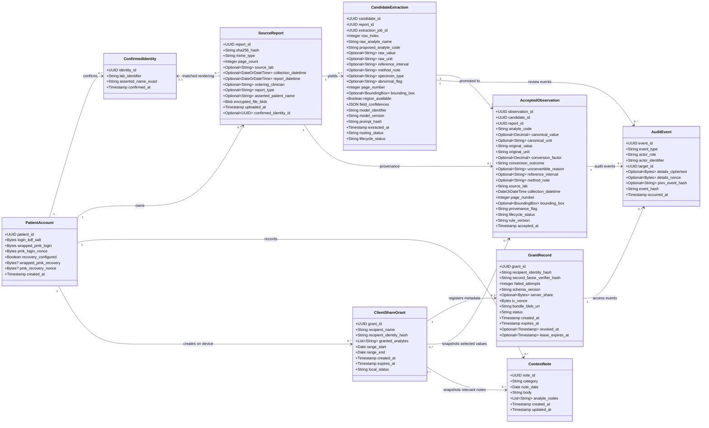

# LabTrail UML Draft

## System overview

LabTrail turns patient-uploaded reports into source-linked result candidates. The patient explicitly accepts, corrects, or rejects each candidate; only accepted observations appear on longitudinal timelines. Patients can add dated context notes and share an immutable, scoped, expiring bundle with a named clinician. LabTrail organizes information but does not interpret results.

## Class choices

- **PatientAccount** represents the patient and their local record/key setup. This refines the initial `Patient` candidate.
- **SourceReport** represents an uploaded source document. This refines `LabReport`.
- **CandidateExtraction** and **AcceptedObservation** separate extracted proposals from patient-verified record values. Together they refine the initial `LabResult` candidate.
- **ClientShareGrant** records the patient's local recipient and scope choices; **GrantRecord** is the corresponding minimal server-side authorization record. Together they refine `ShareGrant`.
- **ConfirmedIdentity**, **ContextNote**, and **AuditEvent** capture identity review, dated context, and auditable patient/recipient actions required by the workflow.

The clinician is represented by a recipient identifier, not a separate class, because identity and authentication are managed by an external system.

## Class diagram

## Modeling notes

- `ContextNote.category` is one of `MEDICATION_CHANGE`, `DIET`, `ILLNESS`, `ACTIVITY`, or `FREE_TEXT`. Each note is linked to one or more unique analyte codes, and `updated_at` cannot precede `created_at`.
- `ContextNote` is a Z1 in-memory model. The persistence layer encrypts the entire serialized note, including category, date, and analyte associations, before storing it in Z3.
- `ClientShareGrant` requires a named recipient, a non-empty unique analyte scope, an ordered date range, and expiry after creation but no more than five calendar years later. `local_status` follows the grant lifecycle states in Figure 6.
- `GrantRecord.status` follows Figure 6 after registration. An active record has a 32-byte `server_share`; locked, expired, revoked, and bundle-refreshing records do not retain it. `revoked_at` is present only for `REVOKED`; `lease_expires_at` is optional and cannot exceed `expires_at`. `iv_nonce` is a 12-byte AES-GCM nonce, and `bundle_blob_uri` points to ciphertext stored in Z3.
- `AuditEvent` contains no unrestricted plaintext metadata. Optional correction details are encrypted on Z1; `details_ciphertext` and its 12-byte nonce are either both present or both absent. The event chain hashes the canonical public envelope and encrypted details; hashes are lowercase 64-character SHA-256 hex digests, and the genesis event has no `prev_event_hash`. `actor_identifier` is an opaque verified identity; patient views resolve patient identity from `PatientAccount` and recipient identity/grant scope from the matching `ClientShareGrant`.
- The first four noun candidates map to `PatientAccount`, `SourceReport`, the `CandidateExtraction`/`AcceptedObservation` pair, and the `ClientShareGrant`/`GrantRecord` pair.
- `PatientAccount` stores only the passphrase KDF salt and wrapped PMK ciphertext/nonces, never plaintext keys or passphrases. Recovery ciphertext and its nonce are both absent when recovery is disabled and both present when it is enabled.
- `SourceReport` keeps its uploaded artifact and content hash immutable while allowing report metadata to be incomplete. Optional collection/report values preserve date-only or date-time precision, including a timezone offset only when the source provides one; confirmed reports link to the patient-scoped `ConfirmedIdentity` for that laboratory rendering.
- `CandidateExtraction` retains nullable source fields, including `method_note` for comparability, four named field-confidence scores, and the extraction job/model/version/prompt-hash provenance. Its normalized bounding box is either absent with `region_available = false` or `[x_min, y_min, x_max, y_max]` in the range 0–1. `routing_status` only routes review; `lifecycle_status` starts at `CANDIDATE` and never implies automatic acceptance.
- Candidate extraction preserves the reported value, unit, and source region. An accepted observation records patient-reviewed and normalized data; an unconvertible value retains its original representation.
- `AcceptedObservation.conversion_outcome` is `CANONICAL_DIRECT`, `CONVERTED_DETERMINISTIC`, or `UNCONVERTIBLE_RETAINED`. Unconvertible values have no canonical value or factor and require an explicit reason. Source page and optional bounding box are snapshotted for one-action provenance; a missing box denotes `REGION_UNAVAILABLE`. Its lifecycle (`ACCEPTED` or `RETRACTED_BY_PATIENT`) is distinct from review provenance (`AS_EXTRACTED` or `CORRECTED_BY_PATIENT`), and its collection value preserves date-only or date-time precision. Optional source `method_note` is retained for comparability checks.
- `ClientShareGrant` is patient-side and contains recipient and scope choices. It copies selected observations and relevant context into an immutable encrypted bundle. Corrections or new results require a new grant; the bundle is not a live link.
- `GrantRecord` is server-side and contains only authorization, expiry, and ciphertext/key-share metadata. It must not contain recipient display names, analyte scope, date range, or clinical values in plaintext.
- Sensitive patient-owned fields are encrypted before persistence in the hosted store. The server audit envelope contains no plaintext clinical values or grant scope; patient views resolve patient identity from `PatientAccount` and grant scope/recipient display identity from `ClientShareGrant`.
