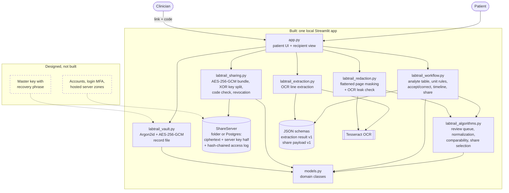
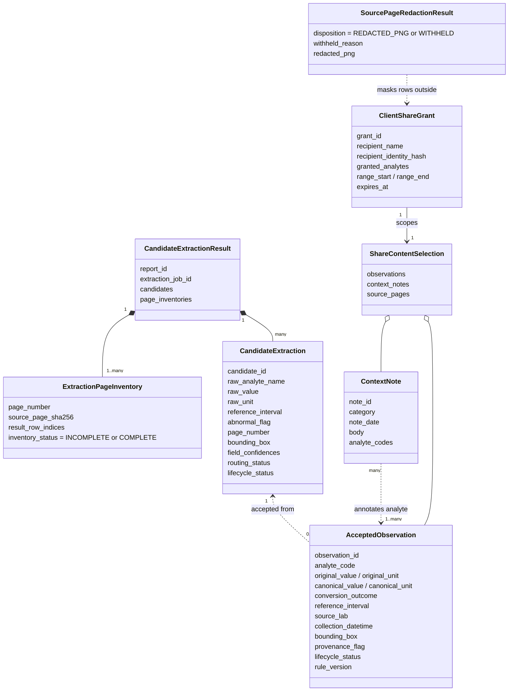
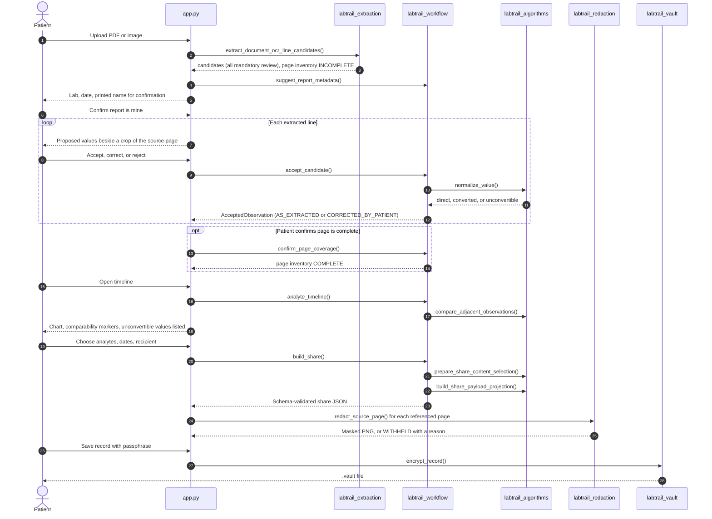
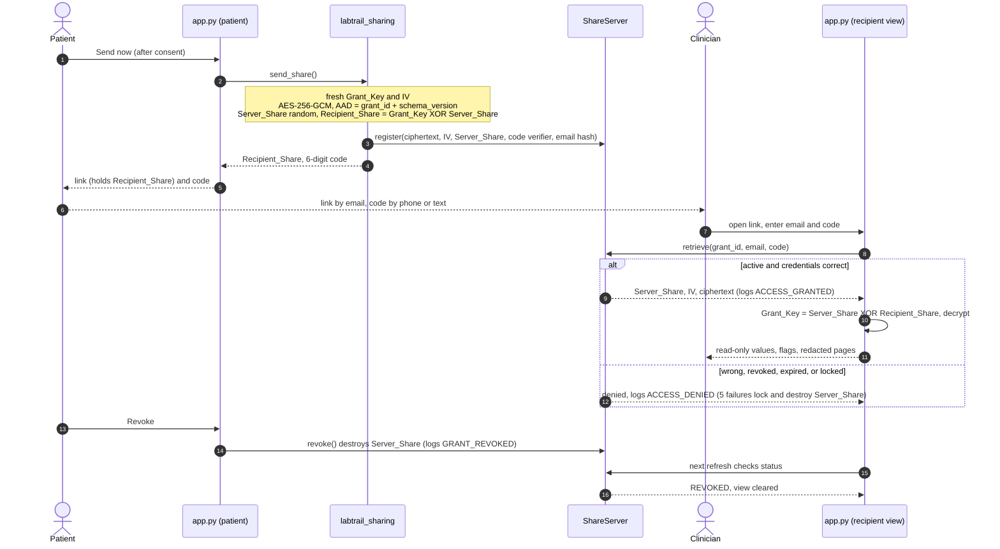
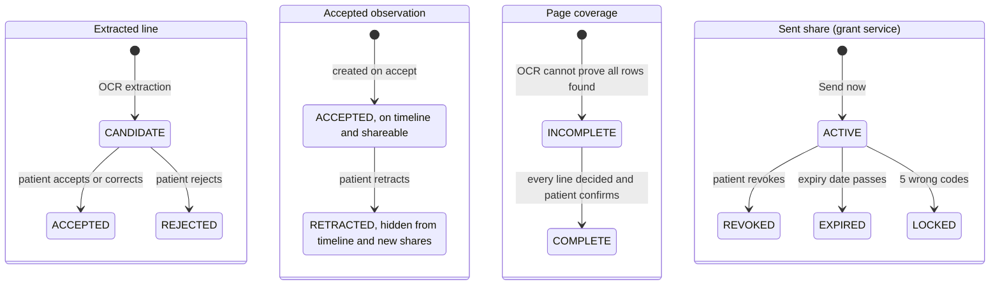

# LabTrail — What Is Built

This document describes the working prototype in this repository. It is
deliberately narrower than the [solution design report](labtrail_solution_design_report_a2_updated.md):
the report describes the full architecture, and this page shows which slice of it
runs today, how the pieces fit together, and how each part is tested.

The prototype runs locally (`streamlit run app.py`) on synthetic lab reports.
It covers one end-to-end path: **upload → confirm → review → timeline → share →
send**, a read-only clinician view opened from the share link, revocation, and
saving the record as an encrypted file.

## 1. Components

Solid boxes are implemented. Dashed boxes are designed in the report but not built.

**Figure 1. Implemented components.** The UI only orchestrates. Every rule a
reviewer might question (what counts as a correction, how units convert, what
a share may contain) lives in plain Python modules with their own tests.

## 2. Domain classes used by the prototype

**Figure 2. Classes the running prototype creates.** `models.py` also defines
`PatientAccount`, `ConfirmedIdentity`, `SourceReport`, `GrantRecord`, and
`AuditEvent` from the report's domain model. They are validated by unit tests
but not used by the demo, because accounts, server storage, and the audit chain
are not built.

## 3. End-to-end sequence

**Figure 3a. One pass through the prototype.** Nothing enters the record without
the patient's explicit accept or correct decision inside the loop, and a source page is shared only if the
patient confirmed it complete and the masked image passes the OCR leak check.

### Sending and opening a share

**Figure 3b. Sending, opening, and revoking a share.** The grant service stores
ciphertext and one key half, so it cannot read the share; the link alone cannot
open it either, because the other half is released only for the right email and code.

## 4. States

**Figure 4. State changes the prototype enforces.** Only a patient action moves
a line out of `CANDIDATE` or a page to `COMPLETE`. Every exit from `ACTIVE`
destroys the server's key half, so the share can never be opened again.

## 5. Changes from the design report

| Area | Report | Prototype | Why |
|---|---|---|---|
| Page coverage | Extraction service declares a page's rows complete | Patient confirms after deciding every line | OCR cannot prove it found every row; the patient already reviews each line against the page image |
| Redaction leak check | Any masked token visible anywhere fails the page | Tokens inside granted rows are ignored by the text search; text inside masks still fails | Shared rows legitimately repeat tokens such as "mg/dL", which made every mixed page fail |
| Extraction | Model-based extraction service | Native PDFs: embedded text layer (exact), plus OCR for text drawn as images; scans and photos: local Tesseract OCR with preprocessing | Runs offline; the text layer avoids OCR misreads on electronic reports; measured in the benchmark |
| Key management | Random master key wrapped by login and recovery keys | Record file encrypted directly with a passphrase-derived key | Shows patient-held keys without accounts or recovery |
| Platform | Browser client with server zones | Single local Streamlit app | Keeps the slice end-to-end within the project timeline |
| Grant service | Hosted blind store with distributed 5-second revocation leases | Runs inside the app; stores grants in Postgres when `LABTRAIL_DATABASE_URL` is set (row-locked transactions), otherwise a local folder; revocation is immediate; expired keys swept | Same key-split and fail-closed behavior without a separate service |
| Link key half | In the URL fragment (`#`), never sent to any server | In a query parameter (`?k=`) | Streamlit cannot read fragments; the grant service code still never receives it |
| Recipient check | Grant credential plus out-of-band second factor | Link plus recipient email and a 6-digit code; 5 failures lock the share | Matches FR-22 with a code the patient can read aloud |

## 6. Requirement coverage

Status: **Built** works end to end in the demo; **Partial** works with the stated gap;
**Not built** is design only.

| Req. | Summary | Status | Where | Tests |
|---|---|---|---|---|
| FR-01 | Upload PDF, PNG, JPEG | Built (25 MiB and pixel limits) | `app.ingest`, `extract_document_ocr_line_candidates` | extraction, smoke |
| FR-02 | Register report metadata | Partial: suggested lab, collection date (ISO, day/month or month/day when unambiguous, month names), and printed name ("Patient Name:", "Name:", or "Mr./Mrs./Ms."), all confirmed by the patient; no report date, ordering clinician, or type | `suggest_report_metadata`, `parse_report_date`, Upload page | workflow, text layer |
| FR-03 | Extract candidate rows with location | Partial: analyte, value, unit, range, flag, page, box, from the PDF text layer when present; no specimen type | `labtrail_extraction` | extraction, text layer, benchmark |
| FR-04 | Map analytes to codes | Partial: 191 tests from the versioned table `reference/lab_tests.csv` suggested from printed names, abbreviations, and OCR look-alikes (ambiguous names are never guessed); patient chooses, or enters a new test name that is kept in their encrypted record and suggested on later uploads; internal codes, not LOINC | `suggest_analyte_code`, `load_analyte_table`, `add_custom_analyte` | workflow, smoke |
| FR-05 | Deterministic unit outcomes | Built: unit rules for glucose and lipids; other tests are charted as reported only when every result shares one unit; text results ("Negative", "<0.5") are kept as printed and listed | `normalize_value`, `CONVERSION_FACTORS`, `plan_chart` | algorithms, workflow |
| FR-06 | Duplicate detection | Partial: identical files skipped with a warning; duplicate results flagged on timeline | `app.ingest`, `find_duplicate_observation_groups` | algorithms |
| FR-07 | Comparability markers | Built | `compare_adjacent_observations`, `analyte_timeline` | algorithms, workflow, smoke |
| FR-08 | No automatic acceptance | Built: every OCR line is mandatory review; lines that start with an identification label (name, DOB, ID, address, contact, report dates, clinician, page footer) are rejected automatically, listed with the reason, and restorable; lines naming a known test never are | `partition_review_queue`, `auto_reject_identification_lines`, Review page | algorithms, workflow, smoke |
| FR-09 | Accept, correct, reject with provenance | Built (activity log is local, not hash-chained) | `accept_candidate` | workflow, smoke |
| FR-10 | Link value to source region | Built: **Source** on any timeline row shows the cropped region and whole page, or says the region is unavailable | `app._show_source` | smoke |
| FR-11 | Context notes | Partial: create and link to analytes; no editing | Timeline page | workflow (share scoping) |
| FR-12 | Chronological analyte view | Built | Timeline page, `analyte_timeline` | workflow, smoke |
| FR-13 | No interpretation | Built: no summaries are computed; a scanner fails the build if any page or the share JSON uses interpretive words | `find_interpretive_language` | workflow, smoke |
| FR-14 | Scoped, expiring grant | Built | `build_share`, `ClientShareGrant` | workflow, schema |
| FR-15 | Revocation within 5 s | Built locally: Revoke destroys the server key half at once; an open recipient view loses access on refresh | `ShareServer.revoke` | sharing, smoke |
| FR-16 | Access log | Built: every registration, open, denial, lock, expiry, and revocation per share, hash-chained and shown to the patient | `ShareServer.events`, `verify_event_chain` | sharing |
| FR-17 | Recipient read-only view | Partial: values, chart, comparability, provenance, notes, redacted pages; no printable summary | `app.page_recipient` | smoke |
| FR-18 | Full export | Partial: share JSON (schema v1) and encrypted record file; no JSON/CSV bundle with source files | `build_share`, `labtrail_vault` | schema, vault |
| FR-19 | Flattened, masked source pages | Built, after patient-confirmed coverage | `redact_source_page`, `confirm_page_coverage` | redaction, workflow, smoke |
| FR-20 | Withhold unreliable pages | Built | `redact_source_page` | redaction, workflow |
| FR-21 | Confirm identity per lab rendering | Partial: confirmed once per lab and printed name; `ConfirmedIdentity` not persisted separately | Upload page | smoke |
| FR-22 | Recipient second factor | Built: link plus email and 6-digit code; lock after 5 failures | `open_share`, `ShareServer.retrieve` | sharing, smoke |
| FR-23 | Patient-held keys and recovery | Partial: passphrase-encrypted record file; no recovery phrase | `labtrail_vault` | vault |
| FR-24 | Retraction | Partial: retracted values leave the timeline and new shares; already-sent shares are not refreshed (revoke and resend) | Timeline page | workflow |

Test files: `tests/test_labtrail_algorithms.py` (algorithms), `test_labtrail_workflow.py`
(workflow), `test_labtrail_extraction.py` (extraction), `test_labtrail_redaction.py`
(redaction), `test_labtrail_vault.py` (vault), `test_share_payload_schema.py` and
`test_candidate_extraction_schema.py` (schema), `test_app_smoke.py` (smoke), `test_text_layer_and_metadata.py` (text layer). Extraction
accuracy is measured separately in [benchmark_results.md](benchmark_results.md).

## 7. Validation summary

- **266 automated tests** run on every push (GitHub Actions), including a test that
  drives the real app through upload, review, timeline, redacted share, and
  encrypted save.
- **Extraction accuracy** (row exact: value, unit, and range all correct): 100% on
  native PDFs in both layouts, 96% on simulated scans, 74% on scans with a flag
  column, 44% on simulated phone photos. Photos are below the design's 90% target.
- **Redaction** is verified by running OCR on the output image: the granted row
  is readable and no other row, name, or lab is.
- **Encryption** is verified by tamper tests: a wrong passphrase, one flipped
  ciphertext bit, or an edited header all fail to open.
- **Sharing** is verified end to end in two app sessions: the clinician is refused
  with a wrong code, opens the share with the right one, and loses access after
  the patient revokes. Tests also show the stored grant contains no readable
  content, that changing the link, ciphertext, nonce, or grant id fails closed,
  and that five wrong codes lock the share.

## 8. Known limitations

- OCR can misread a digit and still look plausible (3.1 read as 9.1). Mandatory
  patient review is the safeguard, not the extractor.
- Text that OCR misses entirely is not in the line list, so it is not masked;
  the patient's page confirmation is the safeguard. Whole-page OCR skips sparse
  text such as letterheads and right-hand header columns on scans and photos
  (native PDFs are read from their text layer instead).
- Barcodes and QR codes are images, not text, so they are never masked.
- The benchmark uses one font and simulated scans; real reports vary more.
- No accounts, hosted server, or recovery phrase. Share links work only where
  this app is reachable (on one machine, or a network you expose it to).
- A share already sent is not updated when the patient retracts a value; the
  patient must revoke and send a new one.
- On Streamlit Community Cloud, uploads, OCR, decryption, and the link's key half
  are processed on the host's servers (the design keeps them in the patient's
  browser). Without a configured database, sent shares are lost when the app restarts.
