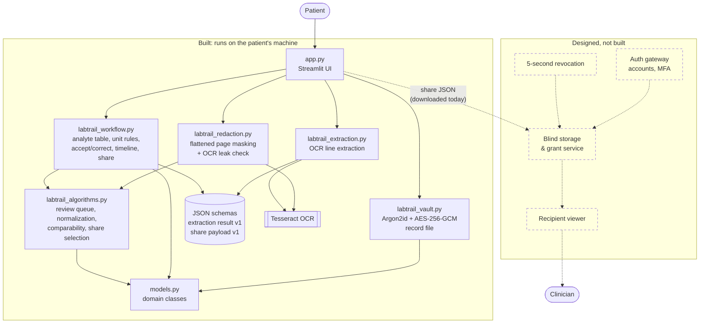
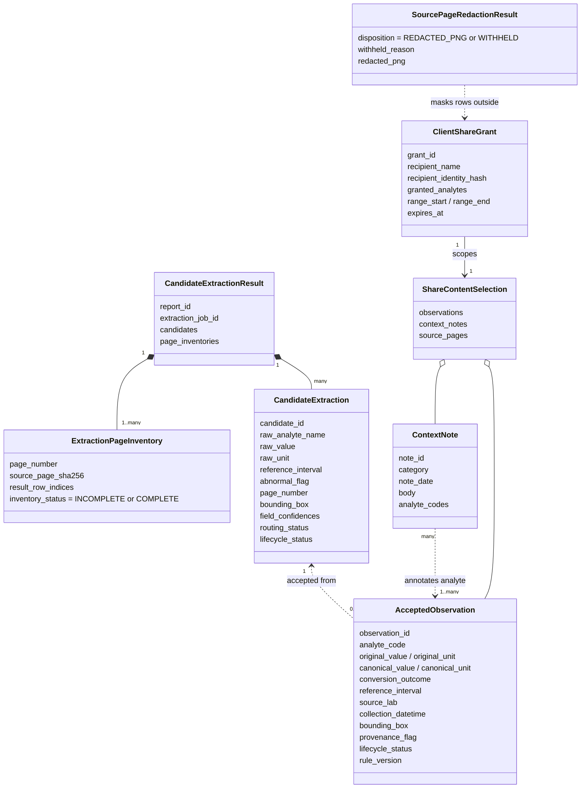
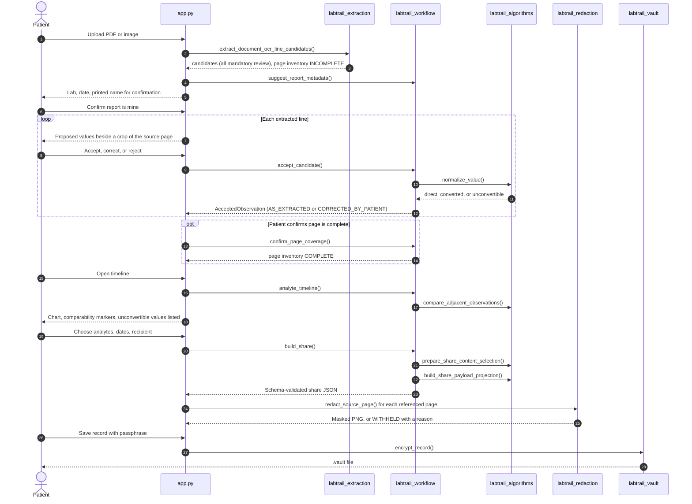
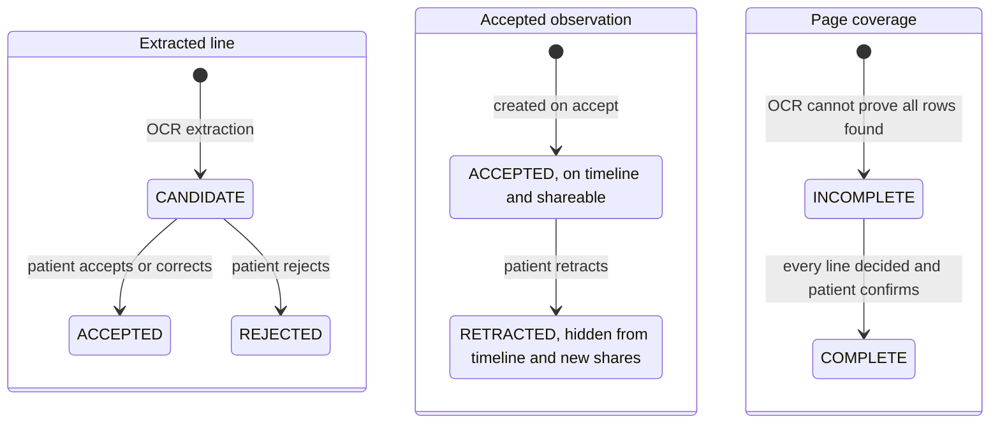

# LabTrail — What Is Built

This document describes the working prototype in this repository. It is
deliberately narrower than the [solution design report](../labtrail_solution_design_report_a2_updated.md):
the report describes the full architecture, and this page shows which slice of it
runs today, how the pieces fit together, and how each part is tested.

The prototype runs locally (`streamlit run app.py`) on synthetic lab reports.
It covers one end-to-end path: **upload → confirm → review → timeline → share**,
plus saving the record as an encrypted file.

## 1. Components

Solid boxes are implemented. Dashed boxes are designed in the report but not built.

**Figure 1. Implemented components.** The UI only orchestrates. Every rule a
reviewer might question (what counts as a correction, how units convert, what
a share may contain) lives in plain Python modules with their own tests.

## 2. Domain classes used by the prototype

**Figure 2. Classes the running prototype creates.** `models.py` also defines
`PatientAccount`, `ConfirmedIdentity`, `SourceReport`, `GrantRecord`, and
`AuditEvent` from the report's domain model. They are validated by unit tests
but not used by the demo, because accounts, server storage, and the audit chain
are not built.

## 3. End-to-end sequence

**Figure 3. One pass through the prototype.** Nothing enters the record without
the patient's explicit accept or correct decision inside the loop, and a source page is shared only if the
patient confirmed it complete and the masked image passes the OCR leak check.

## 4. States

**Figure 4. State changes the prototype enforces.** Only a patient action moves
a line out of `CANDIDATE` or a page to `COMPLETE`.

## 5. Changes from the design report

| Area | Report | Prototype | Why |
|---|---|---|---|
| Page coverage | Extraction service declares a page's rows complete | Patient confirms after deciding every line | OCR cannot prove it found every row; the patient already reviews each line against the page image |
| Redaction leak check | Any masked token visible anywhere fails the page | Tokens inside granted rows are ignored by the text search; text inside masks still fails | Shared rows legitimately repeat tokens such as "mg/dL", which made every mixed page fail |
| Extraction | Model-based extraction service | Local Tesseract OCR with preprocessing | Runs offline on synthetic data; measured in the benchmark |
| Key management | Random master key wrapped by login and recovery keys | Record file encrypted directly with a passphrase-derived key | Shows patient-held keys without accounts or recovery |
| Platform | Browser client with server zones | Single local Streamlit app | Keeps the slice end-to-end within the project timeline |

## 6. Requirement coverage

Status: **Built** works end to end in the demo; **Partial** works with the stated gap;
**Not built** is design only.

| Req. | Summary | Status | Where | Tests |
|---|---|---|---|---|
| FR-01 | Upload PDF, PNG, JPEG | Built (25 MiB and pixel limits) | `app.ingest`, `extract_document_ocr_line_candidates` | extraction, smoke |
| FR-02 | Register report metadata | Partial: lab, collection date, printed name; no report date, ordering clinician, or type | `suggest_report_metadata`, Upload page | workflow |
| FR-03 | Extract candidate rows with location | Partial: analyte, value, unit, range, flag, page, box; no specimen type | `labtrail_extraction` | extraction, benchmark |
| FR-04 | Map analytes to codes | Partial: three internal codes suggested; patient chooses; not LOINC | `suggest_analyte_code` | workflow |
| FR-05 | Deterministic unit outcomes | Built | `normalize_value`, versioned `CONVERSION_FACTORS` | algorithms, workflow |
| FR-06 | Duplicate detection | Partial: identical files skipped with a warning; duplicate results flagged on timeline | `app.ingest`, `find_duplicate_observation_groups` | algorithms |
| FR-07 | Comparability markers | Built | `compare_adjacent_observations`, `analyte_timeline` | algorithms, workflow, smoke |
| FR-08 | No automatic acceptance | Built: every OCR line is mandatory review | `partition_review_queue`, Review page | algorithms, smoke |
| FR-09 | Accept, correct, reject with provenance | Built (activity log is local, not hash-chained) | `accept_candidate` | workflow, smoke |
| FR-10 | Link value to source region | Partial: crop shown during review; not yet clickable from the timeline | Review page `_crop` | — |
| FR-11 | Context notes | Partial: create and link to analytes; no editing | Timeline page | workflow (share scoping) |
| FR-12 | Chronological analyte view | Built | Timeline page, `analyte_timeline` | workflow, smoke |
| FR-13 | No interpretation | Partial: no summaries or interpretive text exist; no automated prohibited-phrase scanner | — | — |
| FR-14 | Scoped, expiring grant | Built | `build_share`, `ClientShareGrant` | workflow, schema |
| FR-15 | Revocation within 5 s | Not built | — | — |
| FR-16 | Access log | Not built | — | — |
| FR-17 | Recipient read-only view | Not built: share is a downloadable JSON file | — | — |
| FR-18 | Full export | Partial: share JSON (schema v1) and encrypted record file; no JSON/CSV bundle with source files | `build_share`, `labtrail_vault` | schema, vault |
| FR-19 | Flattened, masked source pages | Built, after patient-confirmed coverage | `redact_source_page`, `confirm_page_coverage` | redaction, workflow, smoke |
| FR-20 | Withhold unreliable pages | Built | `redact_source_page` | redaction, workflow |
| FR-21 | Confirm identity per lab rendering | Partial: confirmed once per lab and printed name; `ConfirmedIdentity` not persisted separately | Upload page | smoke |
| FR-22 | Recipient second factor | Not built | — | — |
| FR-23 | Patient-held keys and recovery | Partial: passphrase-encrypted record file; no recovery phrase | `labtrail_vault` | vault |
| FR-24 | Retraction | Partial: retracted values leave the timeline and new shares; no active bundles to refresh | Timeline page | workflow |

Test files: `tests/test_labtrail_algorithms.py` (algorithms), `test_labtrail_workflow.py`
(workflow), `test_labtrail_extraction.py` (extraction), `test_labtrail_redaction.py`
(redaction), `test_labtrail_vault.py` (vault), `test_share_payload_schema.py` and
`test_candidate_extraction_schema.py` (schema), `test_app_smoke.py` (smoke). Extraction
accuracy is measured separately in [benchmark_results.md](benchmark_results.md).

## 7. Validation summary

- **115 automated tests** run on every push (GitHub Actions), including a test that
  drives the real app through upload, review, timeline, redacted share, and
  encrypted save.
- **Extraction accuracy** (row exact: value, unit, and range all correct): 100% on
  native PDFs in both layouts, 96% on simulated scans, 74% on scans with a flag
  column, 44% on simulated phone photos. Photos are below the design's 90% target.
- **Redaction** is verified by running OCR on the output image: the granted row
  is readable and no other row, name, or lab is.
- **Encryption** is verified by tamper tests: a wrong passphrase, one flipped
  ciphertext bit, or an edited header all fail to open.

## 8. Known limitations

- OCR can misread a digit and still look plausible (3.1 read as 9.1). Mandatory
  patient review is the safeguard, not the extractor.
- Text that OCR misses entirely is not in the line list, so it is not masked;
  the patient's page confirmation is the safeguard.
- The benchmark uses one font and simulated scans; real reports vary more.
- No accounts, server, recipient view, revocation, or recovery phrase.
