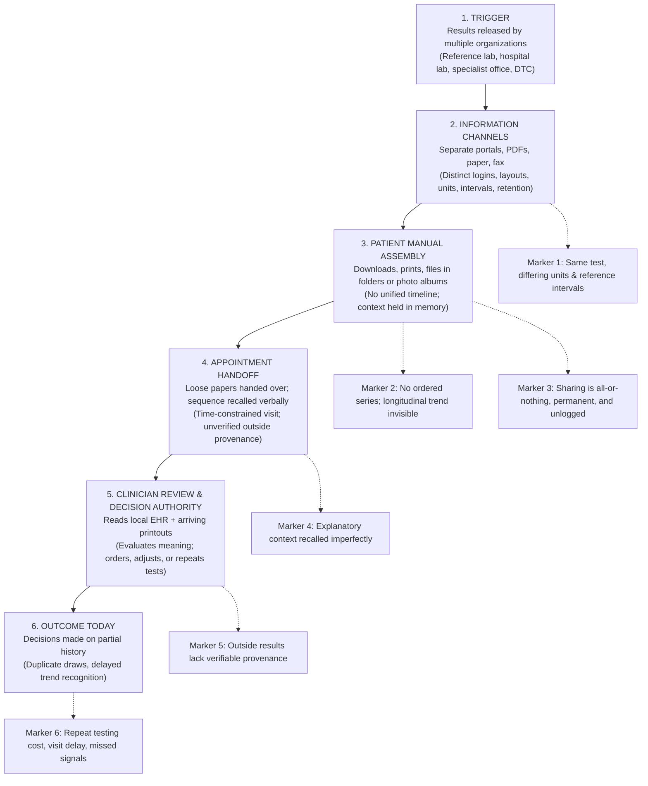
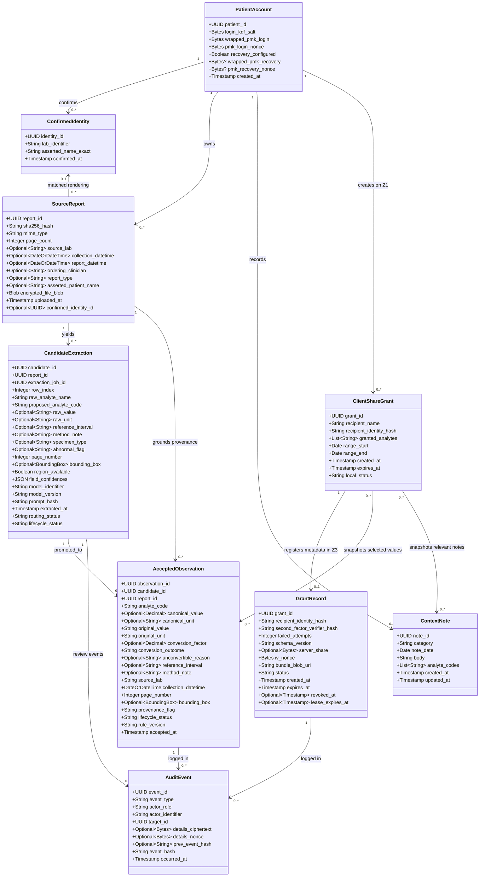
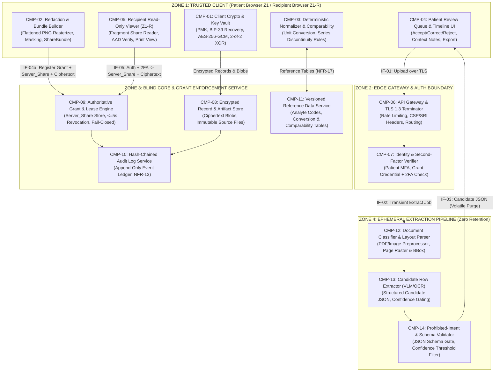
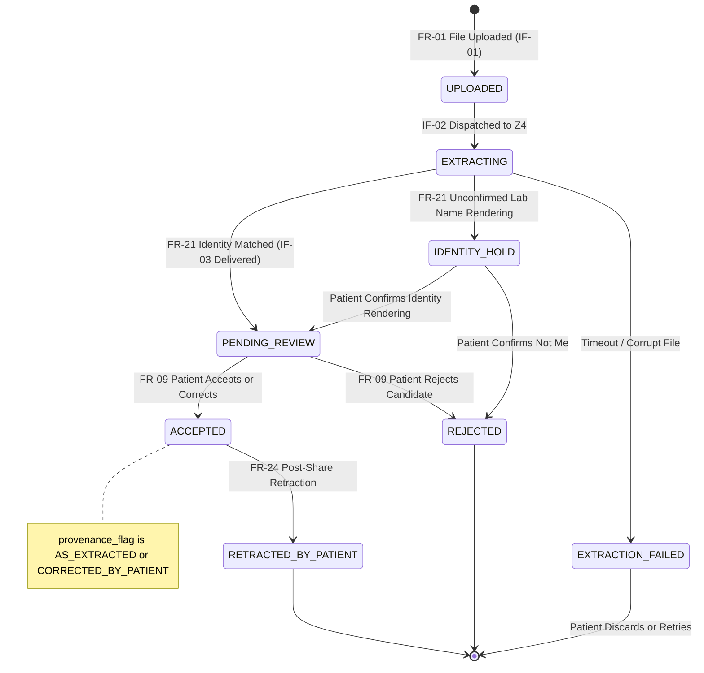
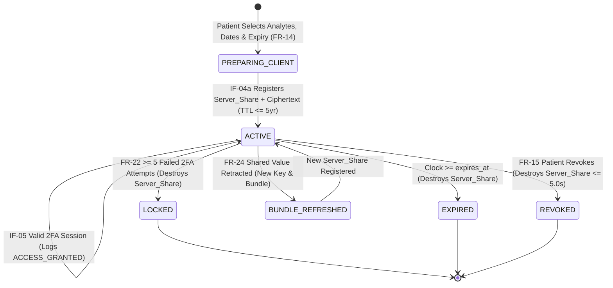

# LabTrail

**A Patient-Controlled Longitudinal Lab Record**  
**Solution Design Report**

**Author:** Renee Raven  
**Email:** rraven2021@fau.edu  
**Course:** CEN 5035 — Software Engineering  
**Instructor:** Dr. Fernando Koch  
**Date:** 11/13/26 *(Cryptographic & Security Revision)*

---

## 1. Executive Summary

### 1.1 The Business Problem

People managing chronic or multi-specialty health conditions rarely receive laboratory work from a single organization. Within a single year, one patient may have specimens drawn at an independent reference laboratory, a hospital inpatient or outpatient laboratory, and a specialist clinic. Each organization releases results through an isolated portal, using distinct document layouts, measurement units, analyte naming conventions, and reference intervals. Patients accumulate a fragmented folder of static documents rather than a longitudinal clinical record.

Consequently, **a single analyte cannot be evaluated across time**. A biomarker trending steadily upward or downward across four draws at three laboratories appears as four disconnected numbers. Longitudinal trends and early clinical signals are easily missed by both patients and clinicians. Meanwhile, explanatory context—such as starting or adjusting a medication, changing diet, experiencing an acute illness, or altering physical activity—exists only in the patient's memory and is reconstructed imperfectly during brief appointments. Treating clinicians see only what resides in their local electronic health record (EHR) plus whatever loose documents the patient brings and recalls.

### 1.2 Proposed Solution Direction

**LabTrail** is a patient-controlled longitudinal laboratory record built as a zero-knowledge hosted service with a trusted client (`Z1`). Patients manually import their existing laboratory reports (PDFs or images). A controlled Document Intelligence pipeline classifies each document, extracts individual result rows as *candidates* alongside page coordinates, normalizes units against versioned conversion tables, and maps analytes to standard codes. Every candidate passes through an explicit **human-in-the-loop review queue**: only values explicitly accepted or corrected by the patient enter the longitudinal record.

Every accepted value remains permanently linked to its immutable source document and page region. Patients can record dated context notes on the same timeline and issue **scoped, time-bounded, revocable share grants** to named recipients (such as treating clinicians). Share bundles are prepared, redacted to flattened text-free raster images, and encrypted directly on the patient's device using **AES-256-GCM** with a **2-of-2 XOR key split**, ensuring the hosting operator can enforce access policy and 5-second revocation without ever reading patient health information.

### 1.3 Architectural Positioning & Capability Boundary

LabTrail follows the **Document Intelligence Agent Pipeline** pattern (`Classify -> Extract -> Normalize -> Assemble -> Verify`), enforcing a strict structural separation between non-deterministic AI extraction (`Z4`) and deterministic normalization, presentation, and access enforcement (`Z1`/`Z3`). Generative AI is restricted exclusively to document classification and candidate row extraction; it is prohibited from interpreting values, diagnosing conditions, scoring risk, or recommending clinical actions.

---

## 2. Problem Context, Stakeholders, and Capability Boundary

### 2.1 Discovery Basis & Operating Context

The problem context derives from direct clinical nursing experience and personal family care advocacy across distributed outpatient and acute care settings:

1. **Acute Care Continuity Gap:** A patient admitted to an inpatient unit reported a critical recent result performed at an external reference laboratory not interfaced with the admitting hospital's EHR. Because no verifiable copy was immediately accessible, treatment decisions were delayed and blood draws were unnecessarily repeated.
2. **Multi-Specialty Chronic Care Fragmentation:** Managing multiple chronic conditions across primary care and subspecialists produced dozens of disconnected reports from multiple laboratories over two years. During specialist consultations, significant appointment time was consumed manually cross-referencing paper printouts rather than evaluating longitudinal trends and medication adjustments.

The operating environment is distributed outpatient care where laboratory testing occurs across unaffiliated organizations over multi-year horizons.

### 2.2 Current Workflow Reference Model

Figure 1 illustrates the current manual workflow, tracing information flow from result release to clinical decision-making and identifying where cost, delay, error, and privacy exposure enter.



**Figure 1 — Scenario Reference Diagram of the Current Workflow.** Solid arrows indicate information and control flow; dashed connectors identify where cost, delay, error, and privacy risk enter.

### 2.3 Capability Boundary

Figure 2 defines the strict boundary between software-supported capabilities and human authority.

```mermaid
flowchart LR
    subgraph INSIDE["INSIDE THE CAPABILITY (Software Enforced)"]
        direction TB
        I1["Manual import & registration of PDF/image reports"]
        I2["Candidate extraction, analyte coding & unit normalization"]
        I3["Duplicate detection & cross-lab comparability flagging"]
        I4["Patient review queue: accept, correct, reject"]
        I5["One-action provenance link to source page & region"]
        I6["Dated patient context notes on analyte timelines"]
        I7["Deterministic single-analyte timeline & export"]
        I8["Scoped, expiring, revocable grants & immutable access log"]
        I9["Read-only recipient view with flattened redacted pages"]
        IA["Patient Authority: Decides what enters record & who sees it"]
    end

    subgraph OUTSIDE["OUTSIDE THE CAPABILITY (Explicitly Prohibited)"]
        direction TB
        O1["Clinical interpretation of any laboratory value"]
        O2["Diagnosis, cause attribution, prognosis, or risk scoring"]
        O3["Treatment, dosing, or follow-up testing recommendations"]
        O4["Clinical alerting requiring medical response"]
        O5["Automated portal/EHR scraping or write-back"]
        O6["Patient-clinician messaging"]
        O7["Imaging, pathology narratives, or genomic data"]
        O8["Ordering, billing, or appointment scheduling"]
        OA["Clinician Authority: Solely interprets results & directs care"]
    end

    INSIDE --- OUTSIDE
```



**Figure 2 — Capability Boundary.** LabTrail improves data availability, normalization, and provenance without shifting clinical judgment into software or weakening patient governance.

### 2.4 Stakeholders & Authority Boundaries

| ID | Stakeholder | Role in System | Primary Goal | Authority Boundary |
| :--- | :--- | :--- | :--- | :--- |
| **SH-01** | **Patient** | Primary user; imports reports, verifies candidates, records context, manages grants. | View one unified history per analyte, capture context, and govern sharing precisely. | **Sole authority** over record acceptance and access grants. **No authority** to request clinical interpretation from software. |
| **SH-02** | **Treating Clinician** | External recipient; views shared subset via browser without account creation. | Review outside results rapidly with verifiable source, units, intervals, and comparability flags. | **Sole authority** to interpret results and make clinical decisions. **No authority** to edit records or extend access. |
| **SH-03** | **Caregiver / Proxy** | Authorized delegate acting on patient's behalf when needed. | Assist with report imports, review preparation, and visit sharing under explicit delegation. | Operates strictly within revocable permissions explicitly granted by **SH-01**. |
| **SH-04** | **Source Laboratory** | Passive originator of source lab reports (no direct system integration in v1). | Accurate attribution of reported values, units, reference intervals, and assay notes. | Authoritative over original report content; source artifacts are immutable (`C-04`). |
| **SH-05** | **Product Owner / Clinical Informaticist Steward** | Maintainer of analyte code mappings, unit conversion factors, and comparability rules. | Ensure deterministic normalization and comparability rules remain accurate and versioned. | Governs versioned reference data (`NFR-17`). **Zero authority** to view patient records. |
| **SH-06** | **Privacy & Security Reviewer** | Governance auditor reviewing data flows and regulatory boundary compliance. | Verify zero-knowledge custody, redaction integrity, and non-SaMD boundary adherence. | Authority to block any release violating privacy rules or Figure 2 (`NFR-16`). |

---

## 3. Requirements Baseline & Architectural Constraints

### 3.1 Functional Requirements (`FR-01` – `FR-24`)

This baseline carries forward `FR-01` through `FR-22` from Assignment 1 (incorporating the reusable grant credential refinement in `FR-22`) and adds `FR-23` (opt-in patient key recovery, resolving `OQ-08`) and `FR-24` (post-share patient retraction governance, resolving `OQ-03`).

| ID | Priority | Functional Requirement | Validation Criterion / Expected Evidence |
| :--- | :--- | :--- | :--- |
| **FR-01** | Must | Accept patient-initiated manual uploads of laboratory reports (machine PDF, scanned PDF, JPEG/PNG image) and create an immutable report record. | Synthetic files of all supported formats upload cleanly, producing one unique `Report` record per file. |
| **FR-02** | Must | Register each report with source laboratory, collection date/time, report date, ordering clinician, report type, and asserted patient identity; hold incomplete metadata for patient completion. | Missing required metadata (e.g., collection date) routes report to review queue with missing fields named; excluded from timelines. |
| **FR-03** | Must | Extract candidate result rows containing analyte name, value, unit, reference interval, specimen type, and printed abnormal flag, plus page number and normalized bounding box. | Labeled evaluation run meets `NFR-09` accuracy thresholds; every candidate carries `(page_number, bbox)` or explicit `region_unavailable`. |
| **FR-04** | Must | Map each candidate analyte to a standard code (LOINC-aligned internal code) using versioned mappings, flagging unrecognized names as `UNMAPPED`. | Synonym names across two labs resolve to one canonical analyte code; fabricated analyte names flag as `UNMAPPED` and block timeline entry. |
| **FR-05** | Must | Resolve every candidate value to one of three deterministic outcomes: (1) converted to canonical unit retaining original value/unit/factor; (2) converted via analyte-specific factor in versioned table; or (3) retained in original unit and excluded from the canonical plotted series where no supported conversion exists. Never force-convert or discard. | Known pairs convert accurately with audit metadata; unconvertible mass/molar pairs remain in original units in a separate non-plotted section with reason stated. |
| **FR-06** | Should | Detect duplicate report files (SHA-256 hash) or duplicate `(analyte, collection_timestamp, source_lab)` entries and route to patient decision. | Re-uploading an identical PDF flags a duplicate reference without inserting duplicate timeline points unless explicitly overridden. |
| **FR-07** | Must | Flag a longitudinal series as not directly comparable wherever source laboratory, assay method note, unit basis, or reference interval changes between consecutive values. | Comparability discontinuity markers render at transition points in patient timelines, exports, and recipient views, naming the differing attribute. |
| **FR-08** | Must | Route low-confidence, internally inconsistent, or conflicting extractions to patient review; prohibit automatic acceptance into the longitudinal record. | Audit log confirms 100% of accepted values have an explicit patient acceptance event; degraded inputs remain in `PENDING_REVIEW`. |
| **FR-09** | Must | Allow the patient to accept, correct, or reject each candidate, recording actor and timestamp; prior/new clinical values in audit details are encrypted on `Z1` before entering the `Z3` log. Corrected values carry `CORRECTED_BY_PATIENT` provenance. | Corrected values appear on timelines and deterministic calculations with `CORRECTED_BY_PATIENT` badge; the patient can decrypt and audit prior/new values, while no plaintext clinical values enter the server audit envelope. |
| **FR-10** | Must | Link every accepted value to its source report, page number, and bounding box (where captured) in one user action; mark missing regions `REGION_UNAVAILABLE`. | Clicking any timeline value opens the source artifact at the exact page with region highlight (or `REGION_UNAVAILABLE` notice for patient). |
| **FR-11** | Must | Allow the patient to create, edit, and associate dated context notes (medication change, diet, illness, activity, free text) with one or more analytes. | Context notes appear at their recorded timestamps on associated analyte timelines with creation/modification timestamps. |
| **FR-12** | Must | Display for a selected analyte all accepted canonical values in chronological order with units, reference interval, source lab, review provenance, comparability markers, context notes, and source-attributed abnormal flags; list unconvertible (`FR-05` outcome 3) values separately below the chart. | Fixture timeline renders all required attributes; abnormal flags display source lab attribution; unconvertible values never plot on the canonical axis. |
| **FR-13** | Must | Compute displayed summary measures strictly via deterministic arithmetic over accepted values; emit zero interpretation, diagnosis, prognosis, risk score, or recommendation. | Automated prohibited-phrase scanner and manual inspection confirm zero interpretive text across UI, exports, and recipient views. |
| **FR-14** | Must | Allow the patient to create a share grant scoped to a named recipient, explicit analyte list, date range, and mandatory expiration timestamp (`NFR-02`). | Attempt to create an unscoped or non-expiring grant is rejected; recipient sees strictly the granted analytes and dates. |
| **FR-15** | Must | Allow the patient to revoke any active grant at any time, destroying server-held key material and denying subsequent access within 5 seconds (`NFR-12`). | Timed revocation test confirms server `Server_Share` destruction and HTTP `403` denial on recipient requests within $\le 5.0\text{ s}$ of revocation acceptance. |
| **FR-16** | Must | Maintain an immutable, patient-visible access log of every grant creation, revocation, verification failure, and recipient access event with verified identity, scope, and timestamp. `Z3` stores an opaque verified actor identifier and grant target; `Z1` resolves patient identity from `PatientAccount` and recipient display identity/scope from `ClientShareGrant`. | Access log displays complete event history and locally resolved identity/scope; no plaintext scope enters the server audit envelope, and attempts by any role to modify or delete log entries fail and generate security audit events. |
| **FR-17** | Must | Present recipients with a read-only browser view of granted values (with provenance, review status, comparability flags, redacted source pages per `FR-19`, and printable summary). | Recipient UI exposes zero edit controls; printable summary and rendered views preserve all provenance and comparability markers. |
| **FR-18** | Should | Allow the patient to export the complete accepted record in an open documented JSON/CSV schema bundled with original source files. | Independent parser built against the published schema reconstructs all accepted timelines and provenance links without loss. |
| **FR-19** | Must | Render source pages served to recipients as flattened raster images with every ungranted result row masked and labeled `REDACTED`; never redact the patient's own view. | Single-analyte grant from a 12-analyte panel serves a flattened PNG where the other 11 rows are masked and OCR/text extraction yields zero ungranted text (`NFR-19`). |
| **FR-20** | Must | Withhold the source page image entirely from a recipient whenever bounding-region data for a granted row is missing or unreliable, serving structured value metadata and an explicit unavailability notice instead. | Report with `REGION_UNAVAILABLE` serves structured value + provenance metadata to recipient with zero image bytes and explicit notice. |
| **FR-21** | Must | Extract asserted patient identity from each report; hold reports with unconfirmed identity renderings in review until confirmed once per laboratory rendering; never merge identities automatically. | Unconfirmed name variation blocks timeline entry until confirmed; subsequent reports with identical lab rendering auto-match; third-party reports are rejected. |
| **FR-22** | Must | Authenticate recipients via the grant credential (`grant_id`) plus a separate out-of-band second factor not embedded in the share URL; allow reusable access across active grant sessions while requiring second-factor verification per session and recording verified identity on every access event. | Presenting the URL without the second factor fails; 5 consecutive failed attempts lock the grant; each valid session logs the verified recipient identity. |
| **FR-23** | Must | Provide an opt-in, client-side recovery key setup (`OQ-08`) generating a 24-word mnemonic phrase on the patient's device to recover the Patient Master Key (`PMK`), with explicit disclosure that the operator cannot reset lost keys. | Patient can export and verify a 24-word recovery phrase offline and restore access to encrypted records on a fresh browser without operator key custody. |
| **FR-24** | Must | Govern post-share retraction (`OQ-03`): if a patient retracts an accepted value previously included in a grant, transition its state to `RETRACTED_BY_PATIENT`, regenerate affected active share bundles without the value, surface a retraction notice, and preserve the immutable audit record. | Retracting a shared value removes it from active timelines and updated share bundles while retaining an immutable retraction event in the audit log. |

### 3.2 Non-Functional Requirements (`NFR-01` – `NFR-20`)

| ID | Category | Measurable Requirement |
| :--- | :--- | :--- |
| **NFR-01** | Privacy | Zero disclosure of record data except via active patient-authorized grants; zero secondary use (no advertising, sale, or model training). Verified by release disclosure inventory. |
| **NFR-02** | Privacy | Default-deny access control; grants restrict access strictly to selected analytes and date range with mandatory expiration $\le 5\text{ years}$ (60 months). |
| **NFR-03** | Security | Client-side encryption of records, source files, and share bundles using **AES-256-GCM** prior to upload; all network transport over **TLS 1.3** (minimum TLS 1.2). |
| **NFR-04** | Security | Patient accounts require MFA (WebAuthn/TOTP); idle patient sessions lock after 15 minutes; recipient links bind to named recipients with per-session second-factor verification. |
| **NFR-05** | Source Traceability | 100% of displayed values in any view, export, or print summary resolve to an immutable stored source artifact and page number (plus bounding box where captured). |
| **NFR-06** | Review Status | Every value carries exactly one lifecycle state (`CANDIDATE`, `ACCEPTED`, `REJECTED`, `RETRACTED_BY_PATIENT`) and accepted values carry `AS_EXTRACTED` or `CORRECTED_BY_PATIENT` provenance. |
| **NFR-07** | Human Authority | Clinical interpretation and access granting/widening are structurally impossible in software; verified by static code review of grant write paths and `FR-13` output checks. |
| **NFR-08** | AI Operating Conditions | Generative models execute only in `Classify` and `Extract` stages; model ID, version, and prompt hash are logged on every candidate; zero auto-acceptance. |
| **NFR-09** | AI Quality Control | On the labeled synthetic benchmark set, field extraction accuracy achieves $\ge 98\%$ on machine-generated PDFs and $\ge 90\%$ on scanned/photographed reports before release. |
| **NFR-10** | Readability | Every displayed value presents units, reference interval, and source laboratory; zero reliance on color alone; WCAG 2.1 AA contrast compliance across all views. |
| **NFR-11** | Response Time | Extraction of a $\le 6$-page report completes in $\le 60\text{ s}$ ($p_{95}$); single-analyte timeline at 500 accepted values renders in $\le 2.0\text{ s}$ ($p_{95}$). |
| **NFR-12** | Revocation Latency | Revocation takes effect within $\le 5.0\text{ s}$ measured from server acknowledgment ($t_{\text{ack}}$) of the patient's revocation request, enforced via authoritative grant reads or bounded revocable leases ($\text{TTL} + \Delta_{\text{skew}} < 5.0\text{ s}$) failing closed. |
| **NFR-13** | Auditability | All review, grant, revocation, retraction, and recipient access events write to a cryptographic hash-chained append-only audit log unmodifiable by any role. Hashes cover the canonical event envelope, including any client-encrypted details and nonce; no plaintext clinical values or grant scope are stored in server-readable audit fields. |
| **NFR-14** | Portability | Complete record export (2,000 accepted values + original source files) completes in $\le 10\text{ minutes}$ in an open, documented schema. |
| **NFR-15** | Availability | 99.5% monthly availability; degraded extraction service does not block reading accepted records; revocation/expiry enforcement always fails closed if authoritative state is unreachable. |
| **NFR-16** | Regulatory Boundary | Operates strictly as a non-diagnostic Personal Health Record (PHR); any feature touching interpretation or alerting requires documented `SH-06` sign-off prior to implementation. |
| **NFR-17** | Change Control | Analyte maps, conversion factors, and comparability rules are versioned reference data owned by `SH-05`; changes require regression passage and never silently alter accepted values. |
| **NFR-18** | Project Data Handling | All development, testing, and demonstration use synthetic or explicitly self-authorized reports; zero third-party PHI is ingested. |
| **NFR-19** | Redaction Integrity | Recipient-served source pages are flattened PNG rasters with zero embedded text layer; OCR/text extraction over served images yields zero ungranted tokens. |
| **NFR-20** | Cryptographic & Client Integrity | Every encryption operation generates a fresh 256-bit key and 96-bit nonce; AES-GCM AAD binds canonical public metadata (`grant_id`, `schema_version`) verified before releasing plaintext; volatile key buffers are zeroized after use; client bundles use reproducible signed builds with Subresource Integrity (SRI). |

### 3.3 Architectural Constraints (`C-01` – `C-08`)

* **C-01 (Identifiable Health Information):** Privacy and default-deny access govern all architectural trade-offs.
* **C-02 (Immovable Clinical Authority):** Software never characterizes, scores, or interprets clinical meaning.
* **C-03 (Immovable Patient Authority):** Software never creates, widens, or extends access grants automatically.
* **C-04 (Immutable Source Artifacts):** Uploaded reports are stored byte-for-byte unaltered; corrections attach exclusively to structured candidate/accepted records.
* **C-05 (Manual Import Only in v1):** Zero runtime dependencies on external EHR or laboratory portal APIs.
* **C-06 (Deterministic Presentation):** All displayed summary calculations are reproducible deterministic functions over accepted values.
* **C-07 (Academic Deliverable Scope):** Architecture and prototypes must be concrete, testable, and verifiable without production clinical deployment.
* **C-08 (Zero-Knowledge Custody & Split-Key Sharing):** The hosted backend (`Z3`) cannot read stored patient records or share bundles. Patient records and source files are encrypted on the patient's device (`Z1`) under keys derived from the Patient Master Key (`PMK`). Share bundles (including `FR-19` flattened redacted rasters) are built on `Z1`, encrypted under a fresh per-grant key $\text{Grant\_Key}$ using **AES-256-GCM**, and protected via a **2-of-2 XOR key split** ($\text{Recipient\_Share} = \text{Grant\_Key} \oplus \text{Server\_Share}$). `Z3` stores `Server_Share` and ciphertext; `Recipient_Share` travels in the URL fragment (`#...`). Revocation destroys `Server_Share` on `Z3`, rendering stored ciphertext undecryptable without requiring recipients to install software or create accounts.

### 3.4 Representative Scenarios (`SC-01` – `SC-05`)

* **SC-01 (Normal Import & Acceptance):** Patient uploads a metabolic panel PDF $\rightarrow$ `Z4` classifies and extracts candidate rows with bounding boxes $\rightarrow$ deterministic engine maps codes and normalizes units $\rightarrow$ patient reviews and accepts $\rightarrow$ values render chronologically on timelines with one-click source page provenance (`FR-01`–`FR-05`, `FR-09`–`FR-12`).
* **SC-02 (Cross-Lab Unit Conversion, Comparability Flag & Correction):** Second lab reports same analyte in alternate units with a different reference interval, plus one OCR digit error and one unconvertible unit $\rightarrow$ conversion engine converts supported unit and flags comparability discontinuity (`FR-07`); OCR error routes to review (`FR-08`) where patient corrects it (`FR-09`); unconvertible analyte lists separately below the chart (`FR-05`, `FR-12`).
* **SC-03 (Dated Context Notes):** Patient logs medication start and dietary change between two lab draws (`FR-11`) $\rightarrow$ notes render on associated timelines at their exact dates without causal claims (`FR-12`, `FR-13`).
* **SC-04 (Scoped Sharing, Redacted Viewing & 5-Second Revocation):** Patient grants specialist access to 2 analytes over 18 months (`FR-14`) $\rightarrow$ `Z1` renders flattened redacted source PNGs (`FR-19`, `NFR-19`), encrypts bundle under AES-256-GCM, uploads `bundle_ciphertext` + `Server_Share` (`IF-04a`), and shares URL `#<Recipient_Share>` + second factor (`FR-22`) $\rightarrow$ clinician views read-only timeline and redacted pages (`FR-17`) $\rightarrow$ patient revokes grant early (`FR-15`) $\rightarrow$ `Z3` destroys `Server_Share` and denies access within $\le 5.0\text{ s}$ (`NFR-12`).
* **SC-05 (Unrecognized Patient Identity Rendering):** Report arrives with middle initial and maiden name variant $\rightarrow$ `FR-21` holds report in review until patient confirms the rendering once; future reports from that lab auto-match; misuploaded family member report is rejected.

### 3.5 AI-Assisted Operating Context

| Pipeline Stage | Approved AI Capability | Prohibited Behavior | Architectural Control |
| :--- | :--- | :--- | :--- |
| **1. Classify** | Classify uploaded document as a laboratory report and detect layout/type. | Judging clinical urgency, importance, or relevance. | Low confidence or non-lab classification routes to patient override (`FR-02`). |
| **2. Extract** | Extract candidate analyte, value, unit, reference interval, specimen, flag, and bounding box. | Inferring missing values, interpolating illegible digits, or altering numbers. | Confidence threshold gating (`NFR-09`); missing fields reported explicitly as `NULL` gaps (`FR-03`, `FR-08`). |
| **3. Normalize** | Propose candidate analyte code mapping for novel strings. | Performing unit conversions or comparability judgments via LLM/ML. | Unit conversions and comparability flags execute strictly via deterministic versioned tables (`FR-05`, `FR-07`, `NFR-17`). |
| **4. Assemble** | Group candidates, flag duplicates (`FR-06`), and highlight missing fields for review. | Generating narrative summaries, trends commentary, or clinical explanations. | Automated prohibited-token filter (`FR-13`); structural separation of `Z4` from presentation (`NFR-07`). |
| **5. Verify** | **None.** Verification is exclusively human (`SH-01` / `SH-03`). | Any automated promotion from `CANDIDATE` to `ACCEPTED`. | Database/client state invariant requiring signed patient acceptance event (`FR-09`, `NFR-08`). |

---

## 4. Domain Model & Core Entities

Figure 4 presents the domain model governing encrypted patient records, candidate extraction provenance, versioned normalization rules, and split-key share grants.



**Figure 4 — Core Domain Model.** Patient-owned classes (`PatientAccount`, `ConfirmedIdentity`, `SourceReport`, `CandidateExtraction`, `AcceptedObservation`, `ContextNote`, and `ClientShareGrant`) are managed in `Z1`; sensitive fields are encrypted under the Patient Master Key hierarchy before any persistence in `Z3`. `ClientShareGrant` holds the patient's recipient and scope choices on `Z1`; selected observations and relevant context are copied into an immutable encrypted bundle. The corresponding `GrantRecord` in `Z3` contains only operational authorization metadata, cryptographic material, expiry/state, and a ciphertext pointer—not the recipient's display name, analyte scope, or date range. The `AuditEvent` server envelope contains no plaintext clinical values or grant scope: patient review details, including prior/new correction values, are encrypted on `Z1` and included as opaque ciphertext in the hash chain; the patient UI resolves recipient identity and scope locally by matching the grant target to `ClientShareGrant`.

`SourceReport` metadata may be incomplete at upload and is completed by the patient before timeline use. Its uploaded artifact and hash remain immutable. Collection and report values preserve date-only or date-time precision, including a timezone offset only when the source provides one; no time or offset is fabricated. A report links to at most one patient-confirmed lab identity, and one confirmed rendering may match multiple reports.

`CandidateExtraction` retains optional `method_note` for comparability and copies the extraction job's model identifier, model version, prompt hash, and extraction timestamp onto each persisted candidate. Its field-confidence object contains exactly `analyte`, `value`, `unit`, and `region`, each in `[0, 1]`. A bounding box is `[x_min, y_min, x_max, y_max]` with normalized coordinates; it is null exactly when `region_available` is false. `routing_status` is separate from the candidate's lifecycle and never accepts a value automatically.

`AcceptedObservation` stores one of the three deterministic conversion outcomes. `UNCONVERTIBLE_RETAINED` requires a reason and has no canonical value or conversion factor; a canonical unit is optional when no target is defined. It snapshots source page and optional bounding box (`null` means `REGION_UNAVAILABLE`), preserves date-only or date-time collection precision, and keeps lifecycle status separate from `AS_EXTRACTED` or `CORRECTED_BY_PATIENT` provenance. Optional source `method_note` values are preserved for FR-07 comparability checks.

`ContextNote.category` is one of `MEDICATION_CHANGE`, `DIET`, `ILLNESS`, `ACTIVITY`, or `FREE_TEXT`. Each note is linked to one or more unique analyte codes, and `updated_at` cannot precede `created_at`.

`ContextNote` is a Z1 in-memory model. The persistence layer encrypts the entire serialized note, including category, date, and analyte associations, before storing it in Z3.

`ClientShareGrant` requires a named recipient, a non-empty unique analyte scope, an ordered date range, and expiry after creation but no more than five calendar years later. `local_status` follows the grant lifecycle states in Figure 6; recipient name and scope remain on Z1 and inside the encrypted bundle rather than being sent as plaintext to Z3.

`GrantRecord.status` follows Figure 6 after registration. An active record has a 32-byte `server_share`; locked, expired, revoked, and bundle-refreshing records do not retain it. `revoked_at` is present only for `REVOKED`; `lease_expires_at` is optional and cannot exceed `expires_at`. `iv_nonce` is a 12-byte AES-GCM nonce, and `bundle_blob_uri` points to ciphertext stored in Z3.

`AuditEvent` has no unrestricted plaintext metadata field. `details_ciphertext` and its 12-byte nonce are present together or absent together; patient-entered review details are encrypted on `Z1`, with canonical public event fields bound as authenticated data. The event hash covers the canonical envelope, including ciphertext and nonce when present. Hashes are lowercase 64-character SHA-256 hex digests. The first event in a chain has a null `prev_event_hash`; subsequent hashes use the preceding event hash. `actor_identifier` is an opaque verified identity, and the patient UI resolves patient identity from `PatientAccount` and recipient identity/access scope from local grant data.

---

## 5. Architectural Overview & Trust Zones

### 5.1 Four-Zone Trust Architecture

To satisfy both zero-knowledge storage (`C-08`) and automated Document Intelligence extraction (`FR-03`) without exposing persistent patient records to the hosting operator, the architecture partitions responsibilities across **four isolated trust zones**:

* **Zone 1 (`Z1`) — Trusted Patient & Recipient Client (Browser / WebAssembly):** Holds the Patient Master Key (`PMK`), executes client-side PDF/image rasterization and `FR-19` black-box redaction, runs deterministic normalization and timeline rendering, performs **AES-256-GCM** encryption/decryption and **2-of-2 XOR key splitting**, and enforces `FR-13` presentation rules. For recipients (`Z1-R`), executes in-browser key reconstruction (`Server_Share` $\oplus$ `Recipient_Share`), canonical AAD verification, and read-only rendering.
* **Zone 2 (`Z2`) — Edge Gateway & Session Boundary:** Terminates TLS 1.3, enforces MFA (`NFR-04`), validates recipient second factors (`FR-22`) with brute-force rate limiting, strips any accidental query parameters, and routes authenticated requests to `Z3` or ephemeral `Z4` workers.
* **Zone 3 (`Z3`) — Blind Core Storage & Authoritative Grant Enforcement Service:** Stores encrypted patient vaults (`Blob` + encrypted metadata), append-only hash-chained audit logs (`NFR-13`), versioned reference tables (`NFR-17`), `GrantRecord` entries containing `server_share` and a reference to `bundle_ciphertext` stored in Z3. `Z3` has **zero cryptographic capability** to decrypt patient records or share bundles, and acts as the authoritative enforcement point for `NFR-12` 5-second revocation.
* **Zone 4 (`Z4`) — Ephemeral Zero-Retention Extraction Pipeline:** Receives a transient, session-scoped decryption capability solely during active report upload (`IF-02`), executes Document Intelligence classification and candidate row extraction (`CMP-12`, `CMP-13`), returns structured `CandidateExtractionResult` JSON (`IF-03`) to `Z1` for client-side encryption, and immediately purges volatile memory and scratch storage upon completion (`NFR-01`, `NFR-08`).



**Figure 3 — System Architecture and Trust Zones (`Z1`–`Z4`).** Plaintext PHI exists only inside the patient's browser (`Z1`), transiently inside ephemeral zero-retention extraction workers (`Z4`) during active upload, and inside the authenticated recipient's browser (`Z1-R`) after successful split-key decryption.

### 5.2 Component Specification Table (`CMP-01` – `CMP-14`)

| ID | Component Name | Trust Zone | Primary Responsibility | Linked Requirements |
| :--- | :--- | :--- | :--- | :--- |
| **CMP-01** | Client Crypto & Key Vault | `Z1` | Derives `PMK`, manages `FR-23` 24-word recovery phrase, executes AES-256-GCM encryption/decryption, performs 2-of-2 XOR key splitting, and zeroizes volatile key memory. | `NFR-03`, `NFR-20`, `FR-23`, `C-08` |
| **CMP-02** | Redaction & Bundle Builder | `Z1` | Renders granted source pages to flattened PNG rasters with ungranted bounding boxes masked (`FR-19`, `NFR-19`), omits missing-region pages (`FR-20`), and serializes `ShareBundle`. | `FR-14`, `FR-19`, `FR-20`, `NFR-19` |
| **CMP-03** | Deterministic Normalizer & Comparability Engine | `Z1` | Executes deterministic unit conversions (`FR-05`), unconvertible value segregation, duplicate detection (`FR-06`), and cross-lab comparability flagging (`FR-07`). | `FR-04`–`FR-07`, `FR-13`, `NFR-17` |
| **CMP-04** | Patient Review Queue & Timeline UI | `Z1` | Presents candidate rows alongside source page crops, captures patient accept/correct/reject decisions (`FR-08`, `FR-09`), manages identity confirmation (`FR-21`), renders timelines (`FR-12`), and handles exports (`FR-18`). | `FR-08`–`FR-13`, `FR-18`, `FR-21`, `FR-24` |
| **CMP-05** | Recipient Read-Only Viewer | `Z1-R` | Reads `#<Recipient_Share>` from URI fragment, clears URL hash, combines `Server_Share` $\oplus$ `Recipient_Share`, verifies canonical AAD, decrypts `bundle_ciphertext`, and renders read-only/print view. | `FR-17`, `FR-19`, `FR-20`, `NFR-10`, `NFR-20` |
| **CMP-06** | API Gateway & TLS Terminator | `Z2` | Enforces TLS 1.3, injects strict CSP and SRI headers, throttles requests, and isolates unauthenticated traffic from core services. | `NFR-03`, `NFR-20` |
| **CMP-07** | Identity & Second-Factor Verifier | `Z2` | Enforces patient MFA (`NFR-04`), idle session timeout (15 min), and recipient `grant_id` + second-factor verification (`FR-22`) with 5-attempt lockout. | `FR-22`, `NFR-02`, `NFR-04` |
| **CMP-08** | Encrypted Record & Artifact Store | `Z3` | Persists immutable encrypted source files (`C-04`) and encrypted patient record objects without access to decryption keys (`C-08`). | `FR-01`, `NFR-01`, `NFR-03`, `C-04`, `C-08` |
| **CMP-09** | Authoritative Grant & Lease Engine | `Z3` | Stores `GrantRecord` metadata and `Server_Share`, enforces $\le 5$-year expiry (`NFR-02`), executes authoritative reads / bounded revocable leases ($\le 5.0\text{ s}$), destroys `Server_Share` on revocation (`FR-15`), and fails closed (`NFR-15`). | `FR-14`, `FR-15`, `NFR-02`, `NFR-12`, `NFR-15` |
| **CMP-10** | Hash-Chained Audit Log Service | `Z3` | Appends tamper-evident, hash-chained audit envelopes for all review, grant, revocation, retraction, and access events; preserves client-encrypted review details as opaque ciphertext, stores no plaintext clinical values or grant scope, and blocks all `UPDATE`/`DELETE` operations. | `FR-09`, `FR-16`, `FR-24`, `NFR-13` |
| **CMP-11** | Versioned Reference Data Service | `Z3` | Serves signed, versioned analyte code maps, conversion tables, and comparability rules managed by `SH-05`. | `FR-04`, `FR-05`, `FR-07`, `NFR-17` |
| **CMP-12** | Document Classifier & Layout Parser | `Z4` | Validates uploaded file format, classifies lab report type, extracts page dimensions, and generates coordinate grids for bounding-box anchoring. | `FR-01`, `FR-02`, `FR-03`, `NFR-08` |
| **CMP-13** | Candidate Row Extractor | `Z4` | Extracts candidate result rows, asserted patient identity, and normalized `[x0, y0, x1, y1]` bounding boxes with per-field confidence scores; purges all memory after `IF-03` response. | `FR-03`, `FR-21`, `NFR-08`, `NFR-09`, `NFR-11` |
| **CMP-14** | Prohibited-Intent & Schema Validator | `Z4` | Validates candidate payloads against `CandidateExtractionResult` JSON Schema, enforces confidence thresholds, and strips any non-factual/interpretive tokens before delivery. | `FR-08`, `FR-13`, `NFR-07`, `NFR-09` |

---

## 6. Assumptions, Resolved Open Questions, and Risk Register

### 6.1 Key Architectural Assumptions

* **A-01:** Patients can download PDFs or capture clear photos of their reports from each laboratory portal.
* **A-02:** Clinicians will utilize a zero-install, browser-based read-only summary when provenance, reference intervals, and comparability caveats are visible at a glance.
* **A-03:** Standard clinical coding (LOINC-aligned codes) covers routine chronic monitoring panels sufficiently to form unified cross-lab series.
* **A-04:** Modern browsers on desktop and mobile devices execute Web Crypto API (AES-256-GCM) and HTML5 Canvas flattened PNG rasterization within interactive latency bounds.

### 6.2 Resolution of Assignment 1 Open Questions

| ID | Open Question from A1 | Architectural Resolution in A2 |
| :--- | :--- | :--- |
| **OQ-01** | How is patient identity matched across differing lab name formats? | **Resolved (`FR-21`):** Never auto-merged. Asserted identity strings are stored verbatim; unrecognized renderings hold in review until confirmed once per `(source_lab, asserted_name_exact)` pair. |
| **OQ-03** | Can a patient delete an accepted value already viewed by a recipient? | **Resolved (`FR-24`):** Accepted values previously shared cannot be silently deleted; patient marks them `RETRACTED_BY_PATIENT`, immediately invalidating/regenerating active share bundles and preserving immutable audit history. |
| **OQ-07** | Under blind hosting (`C-08`), where does extraction run without breaking zero-knowledge custody? | **Resolved (`Z4` Ephemeral Pipeline):** Extraction runs in an isolated, zero-retention compute worker (`Z4`) authorized solely by a transient per-upload session token (`IF-02`), returning candidates to `Z1` for client-side encryption and immediately wiping worker memory/disk. |
| **OQ-08** | What happens if a patient loses their encryption key? | **Resolved (`FR-23`):** Opt-in client-side 24-word BIP-39 mnemonic recovery phrase wraps `PMK` offline on `Z1`, paired with mandatory onboarding disclosure that the operator holds zero recovery capability. |
| **OQ-09** | How does a recipient access a split-key encrypted share without installing software or creating an account? | **Resolved (`IF-05`, `CMP-05`):** Standard browser loads the single-page `Z1-R` web client, extracts `#<Recipient_Share>` locally from the URL fragment, authenticates via `grant_id` + out-of-band second factor (`FR-22`), fetches `Server_Share` + `bundle_ciphertext`, and decrypts in-browser via Web Crypto. |

### 6.3 Risk Register (`R-01` – `R-10`)

| ID | Risk Description | Severity | Architectural Mitigation & Linked Controls |
| :--- | :--- | :--- | :--- |
| **R-01** | Misextracted value accepted into timeline. | High | Confidence gating (`FR-08`, `NFR-09`), side-by-side source crop review (`FR-09`), one-click provenance (`FR-10`). |
| **R-02** | Non-comparable cross-lab results interpreted as a valid trend. | High | Mandatory comparability flags (`FR-07`) carried across timelines, prints, and recipient views (`NFR-10`). |
| **R-03** | Feature creep into clinical interpretation / SaMD territory. | High | Hard architectural exclusion (`Figure 2`), automated prohibited-intent filter (`FR-13`, `CMP-14`), `SH-06` release gate (`NFR-16`). |
| **R-04** | Forgotten or overly broad sharing grants. | Medium | Explicit analyte/date scoping (`FR-14`), mandatory expiration (`NFR-02`), immutable access log (`FR-16`). |
| **R-05** | Faulty conversion factor or unannounced rule update distorts series. | High | Versioned reference data owned by `SH-05`, regression suite gate, no silent recomputation of accepted values (`NFR-17`). |
| **R-06** | Patient review fatigue causes rubber-stamping of candidates. | Medium | Highlight low-confidence/unmapped exceptions, display cropped source row beside input, track correction metrics. |
| **R-07** | Server breach exposes stored health records. | High | Zero-knowledge client-side AES-256-GCM encryption (`C-08`, `NFR-03`), TLS 1.3, MFA (`NFR-04`), append-only audit (`NFR-13`). |
| **R-08** | Clinicians distrust patient-curated data. | Medium | Immutable source artifact linkage (`FR-10`, `NFR-05`), explicit `AS_EXTRACTED` vs. `CORRECTED_BY_PATIENT` badges (`NFR-06`). |
| **R-09** | Recipient source page leaks ungranted panel rows via text layer or bad bbox. | High | Flattened PNG rasterization with zero text layer (`FR-19`, `NFR-19`); full page withholding on missing/unreliable bbox (`FR-20`). |
| **R-10** | **Post-retrieval retention:** Recipient views, prints, screenshots, or locally saves decrypted data—or retains both `bundle_ciphertext` and `Server_Share` captured prior to revocation—and patient later revokes the grant. | High (Residual) | Revocation destroys `Server_Share` within $\le 5.0\text{ s}$ (`NFR-12`), blocking all future server-mediated decryption. Because no technical control can erase data or cryptographic shares already captured on a recipient's device, risk is mitigated by narrow grant scoping (`FR-14`), per-session 2FA (`FR-22`), full access logging (`FR-16`), and a **mandatory verbatim disclosure** shown to the patient before grant creation (Section 7.5.5). |

---

## 7. Detailed Design, Interface Contracts, Cryptographic Protocol & Decision Records

### 7.1 Component Interactions & End-to-End Data Flows

1. **Report Ingestion & Ephemeral Extraction (`IF-01` $\rightarrow$ `IF-02` $\rightarrow$ `IF-03`):** The patient selects a local report in `Z1`. `Z1` computes its SHA-256 hash (`FR-06`), uploads the file over TLS 1.3 (`IF-01`) to `Z2`, which authenticates the session and invokes an isolated `Z4` extraction worker (`IF-02`). `Z4` extracts structured candidates and bounding boxes, validates schema and confidence thresholds (`CMP-14`), returns `CandidateExtractionResult` (`IF-03`), and zeroizes worker memory/disk. `Z1` immediately encrypts both the raw source file and the candidate set under keys derived from `PMK` and persists them to `CMP-08` in `Z3`.
2. **Deterministic Normalization & Patient Verification (`CMP-03`, `CMP-04`):** `Z1` fetches signed reference tables from `CMP-11`, maps analyte codes (`FR-04`), applies deterministic unit conversions (`FR-05`), checks identity confirmation status (`FR-21`), and presents candidates in the review queue (`FR-08`). Patient acceptance or correction (`FR-09`) writes encrypted `AcceptedObservation` records to `CMP-08` and emits a hash-chained audit event to `CMP-10`; any prior/new clinical values are client-encrypted in the event details.
3. **Zero-Knowledge Share Bundle Creation (`IF-04a`):** On `Z1`, `CMP-02` filters accepted values to the granted scope, renders redacted flattened PNGs (`FR-19`, `NFR-19`), serializes `ShareBundle`, encrypts it under a fresh 256-bit `Grant_Key` via AES-256-GCM with canonical AAD, splits `Grant_Key` via 2-of-2 XOR, and registers `grant_id`, `Server_Share`, `IV`, canonical public AAD fields, and `bundle_ciphertext` with `CMP-09` (`IF-04a`).
4. **Recipient Verification, Split-Key Retrieval & Decryption (`IF-05`):** Recipient (`Z1-R`) opens `https://app.labtrail.example/share/<grant_id>#<Recipient_Share>`, submits `grant_id` and the out-of-band second factor (`FR-22`) over `IF-05`, receives `Server_Share`, `IV`, canonical public fields, and `bundle_ciphertext` from `CMP-09`, reconstructs `Grant_Key` and canonical AAD in-browser, and decrypts `ShareBundle` only if GCM authentication succeeds (`NFR-20`).

### 7.2 Interface Contracts (`IF-01` – `IF-05`)

| Interface ID | Source $\rightarrow$ Target | Transport & Auth | Payload Specification | Key Failure & Security Semantics |
| :--- | :--- | :--- | :--- | :--- |
| **IF-01** | `CMP-04` (`Z1`) $\rightarrow$ `CMP-06` (`Z2`) | HTTPS / TLS 1.3; Patient Bearer + MFA (`NFR-04`) | Multipart upload: `file_bytes` (PDF/JPEG/PNG, $\le 25\text{ MB}$), `client_sha256`, `upload_nonce`. | Rejects unsupported MIME types (`415`), oversized payloads (`413`), or expired sessions (`401`). |
| **IF-02** | `CMP-06` (`Z2`) $\rightarrow$ `CMP-12` (`Z4`) | Internal mTLS; Ephemeral Job Token (`TTL = 90s`) | `job_id`, `file_bytes`, `mime_type`, `reference_table_version`. | Worker runs with zero persistent disk and zero outbound network access; hard timeout at `60s` (`NFR-11`). |
| **IF-03** | `CMP-14` (`Z4`) $\rightarrow$ `CMP-04` (`Z1`) | HTTPS / TLS 1.3; Ephemeral Job Token | `CandidateExtractionResult` JSON (Section 7.3) + per-page coordinate metadata. | Worker wipes RAM immediately after `200 OK` delivery; schema failure triggers `502` and retry/manual fallback. |
| **IF-04a** | `CMP-01`/`02` (`Z1`) $\rightarrow$ `CMP-09` (`Z3`) | HTTPS / TLS 1.3; Patient Bearer + MFA | `grant_id`, `recipient_identity_hash`, `second_factor_verifier_hash`, `expires_at`, `schema_version`, `server_share` (256-bit), `iv_nonce` (96-bit), `bundle_ciphertext` (AES-256-GCM output including 128-bit tag). Recipient display name remains on `Z1`; scope (`granted_analytes`, `range_start`, `range_end`) remains on `Z1` and is represented only inside the encrypted bundle. Neither is sent as plaintext metadata. | Rejects if `expires_at` is missing or $> 5\text{ years}$ (`NFR-02`); rejects if plaintext scope, `Recipient_Share`, or `Grant_Key` is present in payload; logs `GRANT_CREATED` (`CMP-10`). |
| **IF-05** | `CMP-05` (`Z1-R`) $\rightarrow$ `CMP-09` (`Z3`) | HTTPS / TLS 1.3; `grant_id` + Per-Session 2FA (`FR-22`) | **Request:** `grant_id`, `second_factor_proof`, `session_nonce`.<br/>**Response:** `grant_id`, `schema_version`, `iv_nonce` (96-bit), `server_share` (256-bit), `bundle_ciphertext`. *(Note: Wrapped keys are deprecated; `bundle_ciphertext` is encrypted directly under `Grant_Key`.)* | Fails closed (`403`/`503`) if revoked, expired, locked out ($\ge 5$ failed 2FA attempts), or lease stale (`NFR-12`, `NFR-15`); logs `ACCESS_GRANTED` or `ACCESS_DENIED` (`CMP-10`). |

### 7.3 Canonical Data Schemas

#### 7.3.1 `CandidateExtractionResult` JSON Schema (`IF-03`)

```json
{
  "$schema": "https://json-schema.org/draft/2020-12/schema",
  "$id": "https://schemas.labtrail.example/v1/candidate-extraction-result.json",
  "title": "CandidateExtractionResult",
  "type": "object",
  "required": [
    "job_id",
    "model_identifier",
    "model_version",
    "prompt_hash",
    "extracted_at",
    "report_metadata",
    "candidates"
  ],
  "additionalProperties": false,
  "properties": {
    "job_id": { "type": "string", "format": "uuid" },
    "model_identifier": { "type": "string", "minLength": 1 },
    "model_version": { "type": "string", "minLength": 1 },
    "prompt_hash": {
      "type": "string",
      "minLength": 1,
      "description": "Hash of the exact extraction prompt; the prompt text itself is not included."
    },
    "extracted_at": { "type": "string", "format": "date-time" },
    "report_metadata": {
      "type": "object",
      "required": [
        "source_laboratory",
        "collection_datetime",
        "report_datetime",
        "ordering_clinician",
        "report_type",
        "asserted_patient_identity",
        "page_count"
      ],
      "additionalProperties": false,
      "properties": {
        "source_laboratory": { "type": ["string", "null"] },
        "collection_datetime": {
          "description": "Date-only, offset date-time, or source-local date-time without an offset; do not invent missing time or timezone information.",
          "anyOf": [
            { "type": "string", "format": "date" },
            { "type": "string", "format": "date-time" },
            { "type": "string", "pattern": "^\\d{4}-\\d{2}-\\d{2}T\\d{2}:\\d{2}(:\\d{2}(\\.\\d+)?)?$" },
            { "type": "null" }
          ]
        },
        "report_datetime": {
          "description": "Date-only, offset date-time, or source-local date-time without an offset; do not invent missing time or timezone information.",
          "anyOf": [
            { "type": "string", "format": "date" },
            { "type": "string", "format": "date-time" },
            { "type": "string", "pattern": "^\\d{4}-\\d{2}-\\d{2}T\\d{2}:\\d{2}(:\\d{2}(\\.\\d+)?)?$" },
            { "type": "null" }
          ]
        },
        "ordering_clinician": { "type": ["string", "null"] },
        "report_type": { "type": ["string", "null"] },
        "asserted_patient_identity": { "type": ["string", "null"] },
        "page_count": { "type": "integer", "minimum": 1 }
      }
    },
    "candidates": {
      "type": "array",
      "items": {
        "type": "object",
        "required": [
          "row_index",
          "analyte_name",
          "value_text",
          "unit_text",
          "reference_interval_text",
          "method_note",
          "specimen_type",
          "abnormal_flag",
          "page_number",
          "bounding_box",
          "region_available",
          "field_confidences",
          "routing_status"
        ],
        "additionalProperties": false,
        "properties": {
          "row_index": { "type": "integer", "minimum": 0 },
          "analyte_name": { "type": "string", "minLength": 1 },
          "value_text": { "type": ["string", "null"] },
          "unit_text": { "type": ["string", "null"] },
          "reference_interval_text": { "type": ["string", "null"] },
          "method_note": { "type": ["string", "null"] },
          "specimen_type": { "type": ["string", "null"] },
          "abnormal_flag": { "type": ["string", "null"] },
          "page_number": { "type": "integer", "minimum": 1 },
          "bounding_box": {
            "description": "Normalized [x_min, y_min, x_max, y_max]; each coordinate is in [0,1], x_min < x_max, y_min < y_max; null exactly when region_available is false.",
            "type": ["array", "null"],
            "items": { "type": "number", "minimum": 0.0, "maximum": 1.0 },
            "minItems": 4,
            "maxItems": 4
          },
          "region_available": { "type": "boolean" },
          "field_confidences": {
            "type": "object",
            "required": ["analyte", "value", "unit", "region"],
            "additionalProperties": false,
            "properties": {
              "analyte": { "type": "number", "minimum": 0.0, "maximum": 1.0 },
              "value": { "type": "number", "minimum": 0.0, "maximum": 1.0 },
              "unit": { "type": "number", "minimum": 0.0, "maximum": 1.0 },
              "region": { "type": "number", "minimum": 0.0, "maximum": 1.0 }
            }
          },
          "routing_status": {
            "type": "string",
            "enum": ["STANDARD_REVIEW", "MANDATORY_EXCEPTION_REVIEW"]
          }
        },
        "allOf": [
          {
            "if": {
              "properties": { "region_available": { "const": true } },
              "required": ["region_available"]
            },
            "then": {
              "properties": { "bounding_box": { "type": "array" } }
            }
          },
          {
            "if": {
              "properties": { "region_available": { "const": false } },
              "required": ["region_available"]
            },
            "then": {
              "properties": { "bounding_box": { "type": "null" } }
            }
          }
        ]
      }
    }
  }
}
```

#### 7.3.2 Canonical Public AAD Structure (`IF-04a` / `IF-05`)

```json
{
  "grant_id": "550e8400-e29b-41d4-a716-446655440000",
  "schema_version": "labtrail.sharebundle.v1"
}
```

### 7.4 Deterministic Processing Rules & Exception Handling Matrix

#### 7.4.1 Core Deterministic Rules

* **Unit Conversion Rule (`FR-05`):** Given `(analyte_code, raw_value, raw_unit)` and `ReferenceDataVersion`:
  1. If `raw_unit == canonical_unit`, outcome is `CANONICAL_DIRECT` (`factor = 1.0`).
  2. Else if `(analyte_code, raw_unit, canonical_unit)` exists in `ConversionTable`, outcome is `CONVERTED_DETERMINISTIC` (`canonical_value = raw_value * factor`), retaining `raw_value`, `raw_unit`, and `factor`.
  3. Else outcome is `UNCONVERTIBLE_RETAINED`: `canonical_value = null`, value is excluded from plotted series (`FR-12`), and listed in the unconvertible table below the timeline with explicit reason.
* **Comparability Rule (`FR-07`):** Adjacent accepted canonical values $v_{i-1}$ and $v_i$ in an analyte series receive a comparability discontinuity marker whenever any of the following hold:
  $$\text{source\_lab}(v_{i-1}) \ne \text{source\_lab}(v_i) \lor \text{unit\_basis}(v_{i-1}) \ne \text{unit\_basis}(v_i) \lor \text{ref\_interval}(v_{i-1}) \ne \text{ref\_interval}(v_i) \lor \text{method\_note}(v_{i-1}) \ne \text{method\_note}(v_i)$$

#### 7.4.2 Comprehensive Exception Handling Matrix (35 Cases)

| # | Pipeline / Runtime Stage | Exception Condition | Detection Mechanism | Deterministic System Response | Linked Req |
| :--- | :--- | :--- | :--- | :--- | :--- |
| 01 | Upload (`IF-01`) | Unsupported file format (e.g., `.docx`, `.exe`) | Magic-byte & MIME inspection (`CMP-06`) | Reject upload with `415 Unsupported Media Type`; list accepted formats. | `FR-01` |
| 02 | Upload (`IF-01`) | Corrupted or password-protected PDF | Parser header check (`CMP-12`) | Reject with actionable prompt asking patient to export an unlocked PDF. | `FR-01` |
| 03 | Upload (`IF-01`) | File exceeds $25\text{ MB}$ or 30 pages | Gateway size/page guard (`CMP-06`, `CMP-12`) | Reject with `413 Payload Too Large`; advise splitting multi-visit packets. | `NFR-11` |
| 04 | Upload (`IF-01`) | Exact file SHA-256 already exists in vault | Client hash lookup (`CMP-03`) | Flag duplicate file (`FR-06`), display prior upload date, require explicit confirmation to proceed. | `FR-06` |
| 05 | Extraction (`Z4`) | Extraction worker timeout ($> 60\text{ s}$) | Worker deadline timer (`IF-02`) | Terminate worker, purge memory, return `504` to `Z1` with retry option; existing records unaffected. | `NFR-11`, `NFR-15` |
| 06 | Extraction (`Z4`) | `Z4` extraction service unreachable / degraded | Circuit breaker in `Z2` (`CMP-06`) | Return `503` for new imports; keep accepted records, timelines, and active grants fully readable. | `NFR-15` |
| 07 | Extraction (`Z4`) | Non-laboratory document uploaded (e.g., billing invoice) | Document classifier (`CMP-12`) | Route to patient review as `NON_LAB_DOCUMENT`; allow override or discard. | `FR-02`, `NFR-08` |
| 08 | Registration | Missing collection date/time on report | Metadata validator (`CMP-04`) | Hold report in review queue naming missing collection date/time; block timeline entry until entered. | `FR-02` |
| 09 | Registration | Missing `source_laboratory` name | Metadata validator (`CMP-04`) | Hold report in review queue prompting patient to enter or select source laboratory. | `FR-02` |
| 10 | Identity (`FR-21`) | Asserted patient name differs from all confirmed renderings | Exact normalized string check (`CMP-04`) | Hold entire report in `IDENTITY_CONFIRMATION_REQUIRED`; block all candidates from timelines. | `FR-21` |
| 11 | Identity (`FR-21`) | Report belongs to another family member | Patient selects "Not my report" (`FR-21`) | Reject report and candidates (`REJECTED`); log event; zero values enter timelines. | `FR-21` |
| 12 | Extraction (`Z4`) | Low field confidence ($< \tau_{\text{conf}}$) on value or unit | Confidence filter (`CMP-14`) | Tag `MANDATORY_EXCEPTION_REVIEW`; highlight low-confidence field in UI (`FR-08`). | `FR-08`, `NFR-09` |
| 13 | Extraction (`Z4`) | Illegible or smudged value on scanned photo | Null value + low confidence (`CMP-13`) | Emit `value_text: null` (never guess); require manual entry or rejection by patient. | `FR-03`, `NFR-08` |
| 14 | Extraction (`Z4`) | Bounding box missing or region confidence $< 0.85$ | Region validator (`CMP-14`) | Set `region_available = false`, `bounding_box = null`; usable by patient (`FR-10`), withheld from recipient images (`FR-20`). | `FR-10`, `FR-20` |
| 15 | Normalization | Unrecognized analyte name (`UNMAPPED`) | Reference map lookup (`CMP-03`) | Flag `UNMAPPED`; hold in review until patient selects standard code or creates custom unmapped series. | `FR-04` |
| 16 | Normalization | Missing unit on extracted numeric value | Unit presence check (`CMP-03`) | Route to review; block canonical conversion until patient supplies unit from source crop. | `FR-05`, `FR-08` |
| 17 | Normalization | Valid unit has no conversion factor to canonical unit | Conversion table lookup (`CMP-03`) | Retain original value/unit (`UNCONVERTIBLE_RETAINED`), exclude from plotted chart, display in table below chart. | `FR-05`, `FR-12` |
| 18 | Normalization | Same `(analyte, collection_datetime, source_lab)` already accepted | Duplicate row detector (`CMP-03`) | Flag row-level duplicate (`FR-06`) referencing existing `observation_id`; require explicit patient decision. | `FR-06` |
| 19 | Normalization | Reference data version updated by `SH-05` | Version comparison (`CMP-03`, `CMP-11`) | Never silently recompute accepted values (`NFR-17`); surface non-intrusive banner offering optional patient review. | `NFR-17` |
| 20 | Output Gate | Candidate or UI text contains prohibited interpretive phrase | Prohibited-intent scanner (`CMP-14`, `FR-13`) | Block rendering/emission, log compliance alert, sanitize to strictly factual attributes. | `FR-13`, `NFR-07` |
| 21 | Provenance | Source artifact or page reference cannot be resolved | Provenance resolver (`CMP-04`, `NFR-05`) | Suppress display of unresolvable value (`NFR-05`) and trigger integrity alert. | `NFR-05` |
| 22 | Grant Creation | Patient attempts to create grant with no expiration date | API & UI schema validation (`IF-04a`) | Reject request (`400 Bad Request`); require explicit expiration timestamp $\le 5\text{ years}$. | `FR-14`, `NFR-02` |
| 23 | Grant Creation | Requested expiration exceeds 5 years (60 months) | Policy validator (`CMP-09`, `NFR-02`) | Reject request (`400 Bad Request`) naming maximum allowed 5-year horizon. | `NFR-02` |
| 24 | Grant Creation | Grant contains zero accepted values in selected scope | Bundle builder check (`CMP-02`) | Warn patient before creation that selected analyte/date slice is currently empty. | `FR-14` |
| 25 | Redaction (`FR-19`) | Page contains both granted and ungranted analyte rows | Bounding-box mask engine (`CMP-02`) | Render flattened PNG with opaque black masks over all ungranted rows + `REDACTED` watermark; verify zero text layer. | `FR-19`, `NFR-19` |
| 26 | Redaction (`FR-20`) | Granted row has `region_available == false` | Bundle builder safety check (`CMP-02`) | Omit page image from `ShareBundle` completely; include structured value + `page_image_withheld_reason`. | `FR-20` |
| 27 | Post-Share Edit | Patient retracts an accepted value included in active grants | Retraction workflow (`FR-24`) | Mark `RETRACTED_BY_PATIENT`, regenerate active affected share bundles without value, log immutable event. | `FR-24` |
| 28 | Recipient Auth | Recipient opens share link without `#<Recipient_Share>` fragment | Client fragment check (`CMP-05`) | Display clear error stating link is incomplete; make zero key-retrieval requests to `Z3`. | `C-08`, `NFR-20` |
| 29 | Recipient Auth | Incorrect second factor submitted on `IF-05` | `CMP-07` verifier | Return `401 Unauthorized`, increment `failed_attempts`, log `ACCESS_DENIED` (`CMP-10`). | `FR-22`, `FR-16` |
| 30 | Recipient Auth | 5 consecutive failed second-factor attempts on a grant | Brute-force guard (`CMP-07`, `CMP-09`) | Transition grant to `LOCKED`, destroy `Server_Share`, notify patient via access log. | `FR-22`, `NFR-04` |
| 31 | Recipient Auth | Recipient accesses an expired grant (`now >= expires_at`) | Policy check (`CMP-09`) | Deny (`403 Forbidden`), purge expired `Server_Share`, log `ACCESS_EXPIRED`. | `FR-14`, `NFR-02` |
| 32 | Revocation | Recipient requests `IF-05` after patient revokes grant | Authoritative / lease check (`CMP-09`) | Deny (`403 Forbidden`) within $\le 5.0\text{ s}$ of $t_{\text{ack}}$; `Server_Share` already zeroized. | `FR-15`, `NFR-12` |
| 33 | Availability | `Z3` enforcement node loses connectivity to primary grant store | Lease / quorum check (`CMP-09`, `NFR-15`) | **Fail closed:** refuse `IF-05` (`503 Service Unavailable`); never serve `Server_Share` on stale/unverified state. | `NFR-12`, `NFR-15` |
| 34 | Decryption | `bundle_ciphertext` or canonical `AAD` tampered in transit/storage | Web Crypto AES-GCM tag verify (`CMP-05`) | `crypto.subtle.decrypt` throws `OperationError`; release zero plaintext bytes; display integrity failure. | `NFR-20` |
| 35 | Key Recovery | Patient forgets password / clears browser storage | Recovery flow (`CMP-01`, `FR-23`) | Prompt for 24-word BIP-39 recovery phrase (`FR-23`) to unwrap `PMK`; if unconfigured, confirm irrecoverability per disclosure. | `FR-23`, `OQ-08` |

---

### 7.5 Cryptographic Design & Key Management

This section specifies the exact cryptographic protocol, trust assumptions, revocation timing guarantees, and residual threat disclosures governing `C-08`, `FR-14`–`FR-23`, `NFR-03`, `NFR-12`, `NFR-15`, and `NFR-20`.

#### 7.5.1 Patient Vault Key Hierarchy (`PMK` & Opt-In Recovery)

1. **Patient Master Key (`PMK`):** Upon account creation in `Z1`, `CMP-01` generates a 256-bit `PMK` using the Web Crypto CSPRNG (`crypto.getRandomValues`). For normal login, `PMK` is wrapped using a Key Encryption Key (`KEK`) derived from the patient's passphrase via **Argon2id** (minimum $64\text{ MiB}$ memory, 3 iterations, 128-bit random salt) bound to WebAuthn/MFA session credentials. The client retains the wrapped PMK, its fresh AES-GCM nonce, and `login_kdf_salt`; the passphrase and plaintext keys never leave `Z1`.
2. **Per-Record Data Encryption Keys (`DEK`):** Each uploaded source artifact (`SourceReport`) and encrypted record partition is encrypted client-side using **AES-256-GCM** with a fresh 256-bit `DEK` and a fresh 96-bit nonce (`IV`), with the `DEK` wrapped under `PMK`.
3. **Opt-In Recovery Phrase (`FR-23` / `OQ-08`):** When the patient enables recovery, `CMP-01` generates a uniformly random 256-bit recovery secret and encodes it as a **24-word BIP-39 mnemonic phrase** in `Z1`. During recovery, the client validates and decodes the phrase, then derives a 256-bit Recovery Key (`RK`) via HKDF-SHA-256 using the RFC 5869 default 32-zero-byte salt and UTF-8 `info` equal to `LabTrail/PMK-recovery/v1:<canonical-lowercase-hyphenated-patient-UUID>`. Argon2id remains for the human-chosen passphrase; it is not needed to slow guessing of this machine-generated high-entropy secret. The client wraps `PMK` with AES-256-GCM using a fresh 96-bit nonce and canonical AAD bound to the patient account, key purpose, and protocol version. `Z3` stores only the encrypted `wrapped_pmk_recovery` and its nonce, enabling recovery on a fresh browser without giving the server the mnemonic, `RK`, or plaintext `PMK`. The client best-effort clears application-managed mnemonic buffers after the patient completes a 3-word verification check; browser runtimes may retain copies. `recovery_configured` must be true exactly when both recovery ciphertext and nonce are present.

#### 7.5.2 Split-Key Share Encryption Protocol (2-of-2 XOR + Direct AES-256-GCM)

Earlier architectural drafts contemplated encrypting `ShareBundle` under a symmetric key and separately wrapping that key; **this design deprecates wrapped keys in favor of direct AES-256-GCM encryption under a 2-of-2 XOR-split `Grant_Key`**.

1. **Key & Nonce Generation (`Z1`):** For each newly created or regenerated share grant (`grant_id`), `CMP-01` generates:
   $$\text{Grant\_Key} \xleftarrow{\$} \{0,1\}^{256}, \qquad \text{IV} \xleftarrow{\$} \{0,1\}^{96}$$
   Every encryption operation uses a freshly generated 256-bit key and 96-bit nonce (`NFR-20`).
2. **Canonical Public Additional Authenticated Data (`AAD`):** `CMP-01` constructs deterministic UTF-8 canonical JSON containing **only public, non-PHI canonical fields**:
   $$\text{AAD} = \text{CanonicalJSON}(\{\texttt{"grant\_id"}: \text{grant\_id},\ \texttt{"schema\_version"}: \text{schema\_version}\})$$
   No patient identifiers, analyte names, or clinical values are placed in `AAD`.
3. **Direct Authenticated Encryption (`Z1`):** `CMP-02` serializes the scoped `ShareBundle` (containing granted `AcceptedObservation` JSON records, associated `ContextNote` items, and flattened text-free `FR-19` PNG rasters) into `plaintext_bundle` and encrypts it directly under `Grant_Key`:
   $$\text{bundle\_ciphertext} = \text{AES-256-GCM-Enc}(\text{Key}=\text{Grant\_Key},\ \text{IV}=\text{IV},\ \text{Plaintext}=\text{plaintext\_bundle},\ \text{AAD}=\text{AAD})$$
   where `bundle_ciphertext` includes the trailing 128-bit GCM authentication tag.
4. **2-of-2 Information-Theoretic Key Split (`Z1`):** `CMP-01` generates a uniform random 256-bit `Server_Share` and computes `Recipient_Share` by bitwise XOR:
   $$\text{Server\_Share} \xleftarrow{\$} \{0,1\}^{256}, \qquad \text{Recipient\_Share} = \text{Grant\_Key} \oplus \text{Server\_Share}$$
   Immediately after computing `Server_Share` and `Recipient_Share`, `CMP-01` overwrites the in-memory buffers holding `Grant_Key` and `plaintext_bundle` with zeros (`NFR-20`).
5. **Registration & Out-of-Band Link Assembly (`IF-04a`):**
   * `Z1` transmits `grant_id`, `Server_Share`, `IV`, `schema_version`, `expires_at`, `recipient_identity_hash`, `second_factor_verifier_hash`, and `bundle_ciphertext` to `CMP-09` (`Z3`) over `IF-04a`. The recipient display name remains client-side; analyte/date scope remains client-side and is represented only inside the encrypted bundle.
   * `Z1` formats the recipient share URL placing `Recipient_Share` exclusively in the **URI fragment**:
     $$\texttt{https://app.labtrail.example/share/}\langle\texttt{grant\_id}\rangle\texttt{\#}\langle\texttt{base64url(Recipient\_Share)}\rangle$$
   * The patient delivers the share URL and the separate out-of-band second factor (`FR-22`) to the recipient.

#### 7.5.3 Recipient Reconstruction, Canonical AAD Verification & Fail-Closed Decryption

1. **Fragment Extraction & Hash Scrubbing (`Z1-R`):** Upon loading the share URL, `CMP-05` reads `window.location.hash` locally in JavaScript, decodes `Recipient_Share` (256 bits) into a volatile `Uint8Array`, and immediately invokes `history.replaceState(null, "", window.location.pathname)` to remove the fragment from the active address bar.
2. **Authenticated Server Share Retrieval (`IF-05`):** The recipient enters the out-of-band second factor (`FR-22`). `CMP-05` sends `(grant_id, second_factor_proof)` over TLS 1.3 to `CMP-09` (`IF-05`). If valid, active, and unrevoked, `CMP-09` logs `ACCESS_GRANTED` (`CMP-10`) and returns `(grant_id, schema_version, iv_nonce, server_share, bundle_ciphertext)`.
3. **In-Browser Key Reconstruction & AAD Binding (`Z1-R`):** `CMP-05` reconstructs:
   $$\text{Grant\_Key} = \text{Server\_Share} \oplus \text{Recipient\_Share}$$
   and independently constructs $\text{AAD} = \text{CanonicalJSON}(\{\texttt{"grant\_id"}: \text{grant\_id},\ \texttt{"schema\_version"}: \text{schema\_version}\})$ from the validated fields.
4. **Fail-Closed Decryption (`NFR-20`):** `CMP-05` invokes Web Crypto `crypto.subtle.decrypt({ name: "AES-GCM", iv: iv_nonce, additionalData: AAD, tagLength: 128 }, Grant_Key, bundle_ciphertext)`.
   * **Zero Plaintext on Failure:** If `grant_id`, `schema_version`, `iv_nonce`, `bundle_ciphertext`, `Server_Share`, or `Recipient_Share` has been altered or mismatched, GCM tag verification fails and throws `OperationError`; **zero bytes of plaintext** are released to the viewer.
   * Upon successful decryption, `CMP-05` zeroizes `Grant_Key`, `Server_Share`, and `Recipient_Share` from volatile memory.

#### 7.5.4 Trust Boundary & URI Fragment Qualifications

* **Trusted-Client Assumption (`C-08`):** Zero-knowledge confidentiality against the hosting operator holds under the **trusted-client assumption**: the hosting operator delivers the HTML/JS/WASM application bundle executed in `Z1` and `Z1-R`. If a compromised operator served malicious client code, that code could exfiltrate keys during client execution. To harden this boundary, all client releases are built reproducibly from public source, signed at release, and served with strict Content Security Policy (`CSP` with `connect-src 'self'`) and Subresource Integrity (`SRI`) hashes (`NFR-20`).
* **URI Fragment HTTP-Request Isolation (Not Out-of-Band):** Placing `Recipient_Share` in the URI fragment (`#...`) guarantees **HTTP-request isolation** per RFC 3986—browsers never transmit the fragment to `Z2`/`Z3` in HTTP requests, server logs, or `Referer` headers. However, the fragment is **not** an out-of-band channel: it is stored in the recipient's browser history, bookmarks, or clipboard if copied, and resides on the recipient's device alongside the active viewer. True multi-factor security therefore relies on the separate out-of-band second factor (`FR-22`) plus immediate `history.replaceState` scrubbing.

#### 7.5.5 Five-Second Revocation Clock, Bounded Leases & Fail-Closed Enforcement (`NFR-12`)

1. **Authoritative Clock Start ($t_{\text{ack}}$):** The 5-second revocation window ($\le 5.0\text{ s}$) begins at timestamp $t_{\text{ack}}$, when `CMP-09` commits the patient's revocation mutation (`status = REVOKED`, `revoked_at = t_ack`) to the primary grant store and returns `200 OK` to `Z1`.
2. **Immediate `Server_Share` Destruction:** Within the same atomic transaction that commits `status = REVOKED`, `CMP-09` overwrites `server_share` with zeros and deletes it from the primary database and all distributed caches, and appends `GRANT_REVOKED` to `CMP-10`. Backups exclude live `Server_Share` columns and rotate backup encryption keys on a 24-hour tombstone cycle.
3. **Authoritative Reads & Bounded Revocable Leases:** Distributed `Z3` enforcement nodes serving `IF-05` must never honor long-lived cached grant states or asynchronous read replicas. Every `IF-05` authorization check must either:
   * Perform a **linearizable (authoritative) read** directly against the primary grant store, **or**
   * Validate a **bounded revocable lease** whose expiration satisfies:
     $$\text{Lease\_TTL} + \Delta_{\text{clock\_skew}} < 5.0\text{ s}$$
     configured in LabTrail at $\text{Lease\_TTL} = 2.0\text{ s}$ with NTP clock-skew monitoring bounded at $\Delta_{\text{clock\_skew}} \le 0.5\text{ s}$ (yielding a worst-case enforcement bound of $2.5\text{ s} < 5.0\text{ s}$).
4. **Fail-Closed Guarantee (`NFR-15`):** If an enforcement node cannot reach the primary grant store, its lease has expired, or NTP clock drift exceeds $0.5\text{ s}$, the node **fails closed** (`503 Service Unavailable`) and refuses to release `Server_Share`.
5. **Best-Effort Active Viewer Closure:** If a recipient already has an open `Z1-R` tab at $t_{\text{ack}}$, `CMP-09` broadcasts a lightweight session-invalidation heartbeat instructing `CMP-05` to clear decrypted DOM state and close the viewer. Because network delivery to an already-open client tab cannot be guaranteed (e.g., if the recipient disconnects Wi-Fi after loading), active viewer closure is explicitly classified as a **best-effort UX signal**; the authoritative security guarantee is server-side destruction of `Server_Share` and rejection of all subsequent `IF-05` requests within $\le 5.0\text{ s}$.

#### 7.5.6 Post-Retrieval Threat Coverage & Verbatim Patient Consent Disclosure (`R-10`)

* **Scope of Post-Retrieval Risk (`R-10`):** Destroying `Server_Share` permanently prevents any future decryption of server-stored `bundle_ciphertext`. However, once a recipient has authenticated over `IF-05` during an active grant, no cryptographic or software control can recall information the recipient has already decrypted, viewed, printed, photographed, or saved locally—including local retention of both `bundle_ciphertext` and `Server_Share` captured during that authorized session.
* **Mandatory Verbatim Patient Consent Disclosure:** Prior to confirming any grant creation in `CMP-04`, the UI presents the following verbatim notice with an explicit acknowledgment checkbox:

> **Patient Consent & Sharing Disclosure (Displayed at Grant Creation):**  
> *"Before you create this share link, please review how your data is protected and what revocation can and cannot do:*  
> *1. **Scoped & Masked Sharing:** Only the specific laboratory analytes and date range you selected are included in this share. Source report pages are converted into flattened images with all other test results permanently masked out.*  
> *2. **How Revocation Works:** You may revoke this grant at any time. Within 5 seconds of your revocation, LabTrail destroys its half of the decryption key, permanently blocking all future access through the share link.*  
> *3. **What Revocation Cannot Undo:** If the recipient has already opened the link while it was active, they may have viewed, printed, photographed, or saved a copy of the shared records—or saved the encrypted bundle and key share—on their own device. Revoking a grant stops all future access only; it cannot delete copies already captured by the recipient."*

---

### 7.6 State Models

#### 7.6.1 Candidate & Report Review Queue State Machine



**Figure 5 — Candidate & Report Review State Machine.** No transition exists from `EXTRACTED` or `PENDING_REVIEW` to `ACCEPTED` without an explicit patient actor event (`FR-08`, `NFR-08`). Review provenance is stored separately as `AS_EXTRACTED` or `CORRECTED_BY_PATIENT`.

#### 7.6.2 Grant Lifecycle & 5-Second Revocation State Machine



**Figure 6 — Grant Lifecycle State Machine.** Terminal states (`LOCKED`, `EXPIRED`, `REVOKED`) enforce immediate cryptographic zeroization of `Server_Share` in `CMP-09`.

---

### 7.7 Sequence Interaction Model

```mermaid
sequenceDiagram
    autonumber
    actor Patient as SH-01 Patient
    participant Z1 as CMP-01..04 (Patient Browser)
    participant Z2 as CMP-06/07 (Edge Gateway)
    participant Z4 as CMP-12..14 (Ephemeral Extract)
    participant Z3 as CMP-08..11 (Blind Core & Grant)
    actor Clinician as SH-02 Recipient
    participant Z1R as CMP-05 (Recipient Browser)

    Note over Patient,Z3: Phase 1: Report Upload, Ephemeral Extraction & Patient Verification
    Patient->>Z1: Select lab report PDF/image
    Z1->>Z2: IF-01 Upload file over TLS 1.3
    Z2->>Z4: IF-02 Ephemeral extraction job
    Z4->>Z1: IF-03 CandidateExtractionResult JSON (Z4 wipes RAM)
    Z1->>Z3: Store encrypted source blob & candidates (PMK-wrapped)
    Patient->>Z1: Confirm identity (FR-21) & accept/correct candidates (FR-09)
    Z1->>Z3: Persist encrypted AcceptedObservations + hash-chained AuditEvent (encrypted correction details)

    Note over Patient,Z1R: Phase 2: Split-Key Share Creation (Direct AES-256-GCM)
    Patient->>Z1: Configure grant scope, expiry & acknowledge R-10 disclosure
    Z1->>Z1: Render flattened redacted PNGs (FR-19), generate Grant_Key (256b) & IV (96b)
    Z1->>Z1: Encrypt ShareBundle with AES-256-GCM + canonical AAD(grant_id, schema_version)
    Z1->>Z1: Split Grant_Key: Recipient_Share = Grant_Key XOR Server_Share; zeroize Grant_Key
    Z1->>Z3: IF-04a Register grant_id, Server_Share, IV, AAD fields, bundle_ciphertext
    Z1-->>Patient: Display URL (https://.../share/grant_id#Recipient_Share) + 2FA code
    Patient-->>Clinician: Deliver share URL and out-of-band 2FA code

    Note over Clinician,Z3: Phase 3: Authenticated Recipient Access & In-Browser Decryption
    Clinician->>Z1R: Open share URL (fragment #Recipient_Share stays in browser)
    Z1R->>Z1R: Read Recipient_Share into volatile RAM & scrub window.location.hash
    Clinician->>Z1R: Enter out-of-band 2FA code
    Z1R->>Z2: IF-05 Request grant_id + second_factor_proof
    Z2->>Z3: Verify 2FA, check authoritative/bounded lease (<5s), log ACCESS_GRANTED
    Z3-->>Z1R: Return Server_Share, IV, grant_id, schema_version, bundle_ciphertext
    Z1R->>Z1R: Reconstruct Grant_Key = Server_Share XOR Recipient_Share & verify canonical AAD
    Z1R->>Z1R: AES-256-GCM decrypt ShareBundle -> render read-only timeline & redacted PNGs

    Note over Patient,Z1R: Phase 4: Early Revocation (<= 5.0s Enforcement)
    Patient->>Z1: Click Revoke Grant (FR-15)
    Z1->>Z3: POST /grants/{grant_id}/revoke
    Z3->>Z3: Commit REVOKED, zeroize/delete Server_Share, log GRANT_REVOKED (t_ack)
    Z3-->>Z1: 200 OK (Revocation confirmed)
    Z3--)Z1R: Best-effort invalidation signal (wipe viewer DOM)
    Clinician->>Z1R: Subsequent refresh / IF-05 request
    Z1R->>Z3: IF-05 Request grant_id
    Z3-->>Z1R: 403 Forbidden (Denied within <= 5.0s of t_ack; Server_Share destroyed)
```

**Figure 7 — End-to-End Sequence Interaction Model.** Illustrates ephemeral `Z4` extraction, client-side AES-256-GCM encryption with 2-of-2 XOR key splitting, fragment-isolated recipient retrieval, and $\le 5.0\text{ s}$ revocation enforcement.

---

### 7.8 Design Decision Records (`DR-01` – `DR-05`)

| ID | Decision Title | Selected Option & Rationale | Rejected Alternatives & Trade-offs |
| :--- | :--- | :--- | :--- |
| **DR-01** | Ephemeral Zero-Retention Extraction (`Z4`) vs. Pure Client-Side ML | **Selected:** Server-side ephemeral worker (`Z4`) executing only during upload (`IF-02`), returning candidate JSON (`IF-03`) to `Z1` for client-side encryption, and wiping RAM/disk immediately.<br/>**Rationale:** Meets `NFR-09` ($\ge 98\%$ PDF / $\ge 90\%$ scan accuracy) and `NFR-11` ($\le 60\text{ s}$) across mobile browsers while preserving blind storage (`C-08`). | *Pure client-side WASM VLM:* Rejected due to $2\text{ GB}+$ model downloads and mobile browser memory crashes.<br/>*Persistent server plaintext:* Rejected as violating `C-08`. |
| **DR-02** | Flattened Raster Redaction (`FR-19`, `NFR-19`) vs. PDF Overlay Masking | **Selected:** Render granted source pages on `Z1` to HTML5 Canvas, draw opaque black masks over all ungranted bounding boxes, export flattened PNG rasters with zero text layer, and omit pages where `region_available == false` (`FR-20`).<br/>**Rationale:** Eliminates hidden PDF text-layer leaks (`R-09`). | *PDF annotation/rectangle overlay:* Rejected because underlying text remains selectable/extractable.<br/>*Withholding all source images:* Rejected as undermining clinician trust (`FR-10`, `R-08`). |
| **DR-03** | 2-of-2 XOR Key Split with URI Fragment & Direct AES-256-GCM (`C-08`) | **Selected:** Encrypt `ShareBundle` directly under a fresh 256-bit `Grant_Key` using AES-256-GCM with canonical public AAD (`grant_id`, `schema_version`); split `Grant_Key` into `Server_Share` (stored in `Z3`) and `Recipient_Share` (placed in URL `#fragment`); require out-of-band 2FA (`FR-22`).<br/>**Rationale:** Enables zero-install browser access (`OQ-09`), blind server storage (`C-08`), HTTP-request isolation of `Recipient_Share`, cryptographic binding of `grant_id`/`schema_version`, and instant server-side revocation by destroying `Server_Share`. Deprecates redundant key-wrapping layers. | *Server-held single encryption key:* Rejected as breaking zero-knowledge custody (`C-08`).<br/>*Recipient public-key encryption:* Rejected because clinicians (`SH-02`) do not hold LabTrail accounts or PGP/WebCrypto keypairs. |
| **DR-04** | Authoritative / Bounded-Lease 5-Second Revocation (`NFR-12`) & Consent Disclosure (`R-10`) | **Selected:** Pin 5-second clock to server acceptance ($t_{\text{ack}}$), destroy `Server_Share` atomically, enforce `IF-05` via authoritative reads or bounded revocable leases ($\text{TTL} + \Delta_{\text{skew}} < 5.0\text{ s}$) failing closed (`NFR-15`), treat active viewer closure as best-effort, and display verbatim `R-10` consent copy at grant creation.<br/>**Rationale:** Eliminates distributed cache race conditions while honestly bounding post-retrieval risks. | *Eventual-consistency read replicas:* Rejected because replication lag can exceed $5.0\text{ s}$.<br/>*Claiming DRM recall of viewed/saved files:* Rejected as technically impossible and misleading to patients (`R-10`). |
| **DR-05** | Deterministic Versioned Reference Tables (`NFR-17`) vs. LLM-Driven Normalization | **Selected:** Store analyte mappings, unit conversion factors, and comparability rules in signed, versioned tables owned by `SH-05` (`CMP-11`); never silently recompute accepted values.<br/>**Rationale:** Guarantees `C-06` deterministic presentation, auditability, and safety against silent series distortion (`R-05`). | *Runtime LLM unit conversion:* Rejected due to hallucination risk on clinical quantities (`R-01`, `R-05`). |

---

## 8. Implementation Plan, Verification Strategy & Traceability

### 8.1 Seven-Increment Implementation Plan (`Increments 0` – `6`)

| Increment | Scope & Delivered Components | Primary Scenarios & Reqs | Exit Evidence / Verification Gate |
| :--- | :--- | :--- | :--- |
| **Inc 0 — Foundation & Crypto Vault** | Repo setup, CI/CD, reproducible build pipeline with SRI (`NFR-20`), `CMP-01` (`PMK`, Argon2id, AES-256-GCM, `FR-23` 24-word recovery), `CMP-06`/`07` auth + MFA, `CMP-08` encrypted blob store, `CMP-10` hash-chained audit log. | `FR-23`, `NFR-03`, `NFR-04`, `NFR-13`, `NFR-20` | Unit tests confirm zero plaintext in `Z3` DB; recovery phrase restores `PMK` offline; audit log rejects `UPDATE`/`DELETE`. |
| **Inc 1 — Ephemeral Extraction & Review Loop** | `Z4` pipeline (`CMP-12`–`14`), `IF-01`–`IF-03`, `CMP-04` review queue with cropped source regions, `FR-21` identity confirmation, `FR-08`/`FR-09` accept/correct/reject. | `SC-01`, `SC-05`, `FR-01`–`FR-03`, `FR-08`–`FR-10`, `FR-21`, `NFR-08`, `NFR-09` | Benchmark run achieves $\ge 98\%$ PDF / $\ge 90\%$ scan accuracy; `Z4` memory wipe verified; unconfirmed names block timelines. |
| **Inc 2 — Deterministic Normalization & Timelines** | `CMP-11` versioned reference service, `CMP-03` unit converter (`FR-05`), duplicate detector (`FR-06`), comparability engine (`FR-07`), `CMP-04` timeline & context notes (`FR-11`, `FR-12`), `FR-13` prohibited-intent scanner. | `SC-02`, `SC-03`, `FR-04`–`FR-07`, `FR-11`–`FR-13`, `NFR-10`, `NFR-11`, `NFR-17` | Cross-lab fixture renders unified canonical series with comparability markers; unconvertible values render below chart; $p_{95}$ render $< 2.0\text{ s}$. |
| **Inc 3 — Split-Key Sharing & Flattened Redaction** | `CMP-02` flattened PNG redactor (`FR-19`, `FR-20`, `NFR-19`), 2-of-2 XOR split + direct AES-256-GCM with canonical AAD (`IF-04a`), `CMP-05` recipient viewer (`Z1-R`), `FR-22` 2FA verification, verbatim `R-10` disclosure. | `SC-04` (Part 1), `FR-14`, `FR-17`, `FR-19`, `FR-20`, `FR-22`, `NFR-19`, `NFR-20` | OCR/text extraction over recipient PNGs yields zero ungranted tokens; missing bbox omits image; AAD tamper test fails closed. |
| **Inc 4 — 5-Second Revocation, Leases & Retraction** | `CMP-09` authoritative/bounded-lease engine ($\text{TTL} = 2.0\text{ s}$), atomic `Server_Share` destruction (`FR-15`, `NFR-12`), fail-closed partition handling (`NFR-15`), `FR-16` access log, `FR-24` post-share retraction. | `SC-04` (Part 2), `FR-15`, `FR-16`, `FR-24`, `NFR-02`, `NFR-12`, `NFR-15` | Automated timer verifies denial within $\le 5.0\text{ s}$ of $t_{\text{ack}}$; network partition fault injection confirms fail-closed `503`. |
| **Inc 5 — Full Record Portability & Export** | `FR-18` open-schema JSON/CSV + original source files export bundler (`CMP-04`), independent schema reader verification (`NFR-14`). | `FR-18`, `NFR-05`, `NFR-14` | 2,000-value synthetic vault exports in $< 10\text{ min}$ and round-trips losslessly through independent reference parser. |
| **Inc 6 — Hardening, Accessibility & Boundary Audit** | WCAG 2.1 AA contrast & screen-reader audit (`NFR-10`), `SH-06` regulatory boundary & disclosure inventory review (`NFR-01`, `NFR-16`), synthetic dataset provenance sign-off (`NFR-18`). | `NFR-01`, `NFR-10`, `NFR-16`, `NFR-18` | Zero WCAG AA violations; signed `SH-06` release gate checklist; complete end-to-end regression suite pass. |

* **Prototype Cut Line:** Increments `0` through `4` constitute the core architectural prototype demonstrating end-to-end zero-knowledge import, human-verified normalization, flattened redaction, split-key sharing, and $\le 5.0\text{ s}$ revocation.

### 8.2 AI-Assisted Development Boundaries & Verification Gates

* **Permitted AI Coding Assistance:** Generating boilerplate UI components, JSON Schema validators, synthetic non-PHI laboratory report fixtures (`NFR-18`), and unit test scaffolding.
* **Mandatory Human Implementation & Line-by-Line Review:** All cryptographic primitives (`CMP-01`, `CMP-05`), key zeroization routines, canonical AAD construction, bounded-lease revocation logic (`CMP-09`), and prohibited-intent filters (`CMP-14`) must be manually authored or line-by-line audited against Web Crypto and NIST SP 800-38D specifications before merge.

### 8.3 Traceability Matrices

#### 8.3.1 Functional Requirements Traceability Matrix (`FR-01` – `FR-24`)

| FR ID | Implementing Components | Interfaces / State Models | Verification Method & Increment |
| :--- | :--- | :--- | :--- |
| **FR-01** | `CMP-04`, `CMP-06`, `CMP-08`, `CMP-12` | `IF-01`, `IF-02` / Fig. 5 | Multi-format synthetic upload integration test (Inc 1) |
| **FR-02** | `CMP-04`, `CMP-12`, `CMP-13` | `IF-03` / Fig. 5 | Missing-field hold & registration unit/E2E test (Inc 1) |
| **FR-03** | `CMP-12`, `CMP-13`, `CMP-14` | `IF-03` (`CandidateExtractionResult`) | Labeled synthetic benchmark accuracy & bbox test (Inc 1) |
| **FR-04** | `CMP-03`, `CMP-11` | Reference Data API | Synonym mapping & `UNMAPPED` flag test (Inc 2) |
| **FR-05** | `CMP-03`, `CMP-11` | Deterministic Conversion Rule | 3-outcome unit conversion & unconvertible retention test (Inc 2) |
| **FR-06** | `CMP-03`, `CMP-04` | Hash & Row Duplicate Check | Re-import file & row duplicate detection test (Inc 2) |
| **FR-07** | `CMP-03`, `CMP-04`, `CMP-05` | `AcceptedObservation` source lab, unit, reference interval, and `method_note` | Cross-lab discontinuity badge test across UI/print/share (Inc 2) |
| **FR-08** | `CMP-04`, `CMP-14` | Fig. 5 (`PENDING_REVIEW`) | Degraded input routing & zero-auto-accept audit test (Inc 1) |
| **FR-09** | `CMP-04`, `CMP-10` | Fig. 5 (`ACCEPTED` / `REJECTED`; separate provenance flag) | Correction provenance & prior-value audit test (Inc 1) |
| **FR-10** | `CMP-04`, `CMP-08` | `AcceptedObservation.page_number/bounding_box` | One-click source page & region highlight test (Inc 1) |
| **FR-11** | `CMP-04`, `CMP-08` | `ContextNote` Entity | Dated note creation, association & timeline placement test (Inc 2) |
| **FR-12** | `CMP-03`, `CMP-04` | Deterministic Timeline Renderer | Chronological ordering, source flags & unconvertible table test (Inc 2) |
| **FR-13** | `CMP-03`, `CMP-04`, `CMP-14` | Prohibited-Intent Filter | Automated phrase-list scan & deterministic recomputation test (Inc 2) |
| **FR-14** | `CMP-02`, `CMP-09` | `IF-04a` / Fig. 6 | Scope enforcement & missing-expiry rejection test (Inc 3) |
| **FR-15** | `CMP-04`, `CMP-09`, `CMP-10` | `IF-05` / Fig. 6 (`REVOKED`) | Timed $\le 5.0\text{ s}$ revocation & `Server_Share` erasure test (Inc 4) |
| **FR-16** | `CMP-04`, `CMP-09`, `CMP-10` | `AuditEvent` Hash Chain | Access log completeness & immutability test (Inc 4) |
| **FR-17** | `CMP-05` | `IF-05` (`Z1-R` Viewer) | Read-only UI, provenance preservation & print summary test (Inc 3) |
| **FR-18** | `CMP-01`, `CMP-04`, `CMP-08` | Open Export Schema | Full archive export & independent schema parser test (Inc 5) |
| **FR-19** | `CMP-02`, `CMP-05` | Flattened PNG Canvas Pipeline | Multi-analyte panel masking & OCR zero-leak test (Inc 3) |
| **FR-20** | `CMP-02`, `CMP-05` | `region_available == false` Fallback | Missing-region page withholding & notice test (Inc 3) |
| **FR-21** | `CMP-04`, `CMP-13` | `ConfirmedIdentity` / Fig. 5 | Name variation hold, one-time confirm & mismatch reject test (Inc 1) |
| **FR-22** | `CMP-05`, `CMP-07`, `CMP-09` | `IF-05` + Out-of-Band 2FA | Reusable session 2FA test & 5-attempt lockout test (Inc 3) |
| **FR-23** | `CMP-01`, `CMP-08` | 24-Word BIP-39 Recovery Flow | Offline mnemonic backup & fresh-browser `PMK` restore test (Inc 0) |
| **FR-24** | `CMP-02`, `CMP-04`, `CMP-09`, `CMP-10` | Fig. 5 & Fig. 6 (`RETRACTED_BY_PATIENT`) | Post-share value retraction, bundle refresh & audit test (Inc 4) |

#### 8.3.2 Non-Functional Requirements Traceability Matrix (`NFR-01` – `NFR-20`)

| NFR ID | Architectural Mechanism | Verification Evidence |
| :--- | :--- | :--- |
| **NFR-01** | Blind `Z3` storage (`C-08`), zero-retention `Z4`, strict CSP | Release data-flow & disclosure inventory audit (Inc 6) |
| **NFR-02** | Default-deny `CMP-09` policy, mandatory `expires_at <= 5 yr` | Out-of-scope, expired, and $> 5$-year grant rejection tests (Inc 3–4) |
| **NFR-03** | Client-side AES-256-GCM (`CMP-01`), TLS 1.3 (`CMP-06`) | Ciphertext storage inspection & TLS configuration scan (Inc 0) |
| **NFR-04** | `CMP-07` MFA, 15-min idle lock, per-session recipient 2FA | Auth session timeout & MFA bypass test suite (Inc 0, Inc 3) |
| **NFR-05** | Mandatory `(report_id, page_number)` foreign key & resolver | Automated provenance resolver check over 100% of rendered values (Inc 2) |
| **NFR-06** | Explicit state enums in domain model (Fig. 4 & Fig. 5) | State invariant & export/UI provenance badge tests (Inc 1–2) |
| **NFR-07** | Structural isolation of `Z4` from UI; `CMP-09` write-path guard | Static code review of grant mutations & `FR-13` output checks (Inc 2, Inc 4) |
| **NFR-08** | `CandidateExtractionResult` model metadata + `PENDING_REVIEW` gate | Audit verification of model version tags & acceptance events (Inc 1) |
| **NFR-09** | `CMP-13`/`14` confidence threshold gate against labeled corpus | CI benchmark gate ($\ge 98\%$ PDF, $\ge 90\%$ image) (Inc 1) |
| **NFR-10** | `CMP-04`/`05` text labels, explicit units/intervals, WCAG AA palette | Automated axe-core contrast scan & comprehension check (Inc 2, Inc 6) |
| **NFR-11** | Ephemeral `Z4` sizing & client-side indexed timeline rendering | Load test: 6-page extract $\le 60\text{ s}$; 500-point timeline $\le 2.0\text{ s}$ (Inc 1–2) |
| **NFR-12** | Atomic `Server_Share` deletion + authoritative/bounded lease ($< 5.0\text{ s}$) | Automated revocation latency benchmark from $t_{\text{ack}}$ to `403` (Inc 4) |
| **NFR-13** | `CMP-10` append-only SHA-256 hash-chained audit ledger | Role-based modification denial & hash-chain verification test (Inc 0, Inc 4) |
| **NFR-14** | Streaming client-side ZIP/JSON export bundler (`CMP-04`) | 2,000-value export timing ($\le 10\text{ min}$) & schema round-trip (Inc 5) |
| **NFR-15** | Decoupled `Z3` storage vs. `Z4` extraction; fail-closed `CMP-09` | Fault injection on `Z4` outage & `Z3` partition fail-closed test (Inc 4) |
| **NFR-16** | `Figure 2` exclusion boundary & mandatory `SH-06` sign-off | Signed `SH-06` regulatory boundary review artifact (Inc 6) |
| **NFR-17** | `CMP-11` signed versioned tables & non-destructive accepted values | Reference table regression test & non-recomputation check (Inc 2) |
| **NFR-18** | Synthetic generator & dataset provenance manifest | Dataset provenance audit confirming zero third-party PHI (Inc 0–6) |
| **NFR-19** | HTML5 Canvas flattened PNG raster export (`CMP-02`) | Automated Tesseract/PDF-text extraction returning empty string (Inc 3) |
| **NFR-20** | Fresh 256b key/96b IV, canonical AAD verify, RAM zeroization, SRI | Crypto unit test suite, AAD tamper test & SRI header check (Inc 0, Inc 3) |

#### 8.3.3 Stakeholder Goal Traceability Matrix (`SH-01` – `SH-06`)

| Stakeholder | Core Goal | Supporting Requirements | Architectural Elements |
| :--- | :--- | :--- | :--- |
| **SH-01 (Patient)** | Unified cross-lab history, context capture, verified accuracy, and granular revocable sharing. | `FR-01`–`FR-16`, `FR-18`–`FR-24`, `NFR-01`–`NFR-06`, `NFR-12`–`NFR-14`, `NFR-20` | `Z1` Trusted Client (`CMP-01`–`04`), `Z4` Ephemeral Extractor, `CMP-09` Grant Engine, `CMP-10` Audit Log |
| **SH-02 (Clinician)** | Fast, trustworthy read-only view of outside results with provenance and comparability; sole clinical authority. | `FR-07`, `FR-10`, `FR-12`, `FR-13`, `FR-17`, `FR-19`, `FR-20`, `NFR-05`, `NFR-10` | `CMP-05` Recipient Viewer (`Z1-R`), `CMP-02` Flattened Redaction, `CMP-03` Comparability Engine |
| **SH-03 (Caregiver)** | Explicit, revocable delegated assistance on patient's behalf. | `FR-09`, `FR-14`, `FR-16`, `NFR-04`, `NFR-13` | `CMP-07` Delegated Auth Scope, `CMP-10` Actor-Attributed Audit Trail |
| **SH-04 (Source Lab)** | Accurate attribution of values, units, intervals, and unaltered source documents. | `FR-02`, `FR-10`, `FR-12`, `FR-21`, `C-04` | `CMP-08` Immutable Artifact Store, `ConfirmedIdentity` (`FR-21`) |
| **SH-05 (Steward)** | Govern versioned analyte mappings, unit conversions, and comparability rules without PHI access. | `FR-04`, `FR-05`, `FR-07`, `NFR-17`, `C-08` | `CMP-11` Versioned Reference Data Service, Blind `Z3` Isolation |
| **SH-06 (Privacy/Sec)** | Verify zero-knowledge custody, redaction integrity, and strict non-SaMD boundary. | `FR-13`, `FR-19`, `FR-20`, `NFR-01`, `NFR-07`, `NFR-16`, `NFR-18`–`NFR-20` | `Figure 2` Boundary, `CMP-14` Intent Filter, `CMP-01`/`02` Crypto & Raster Redaction |

---

## Appendix A: Comprehensive Change Log (`CL-01` – `CL-40`)

### Part A — Assignment 1 Baseline Refinements (`CL-01` – `CL-15`)

* **CL-01:** Established Document Intelligence pipeline framing (`Classify -> Extract -> Normalize -> Assemble -> Verify`) with strict human-in-the-loop verification (`FR-08`, `FR-09`).
* **CL-02:** Defined explicit capability boundary (`Figure 2`) excluding clinical interpretation, diagnosis, risk scoring, and alerting (`FR-13`, `NFR-16`).
* **CL-03:** Added `SH-02` (Treating Clinician) as an unauthenticated read-only recipient stakeholder (`FR-17`).
* **CL-04:** Added `FR-10` one-action provenance linking every accepted value to its source report page and bounding region.
* **CL-05:** Resolved conflict between `FR-10` provenance and `FR-17` grant scope by introducing `FR-19` bounding-box row masking and `NFR-19` flattened text-free raster rendering.
* **CL-06:** Added `FR-20` fail-safe withholding of source images when bounding-region capture is unreliable.
* **CL-07:** Added `FR-05` three-outcome deterministic unit conversion rule, segregating unconvertible values below the chart (`FR-12`) rather than plotting incomparable points.
* **CL-08:** Added `FR-07` cross-laboratory comparability discontinuity marking across timelines, prints, and recipient views.
* **CL-09:** Resolved `OQ-01` via `FR-21` one-time per-laboratory identity confirmation without automatic identity merging.
* **CL-10:** Added `FR-22` out-of-band second-factor recipient verification to bind `FR-16` access logs to verified recipient identities.
* **CL-11:** Introduced `C-08` zero-knowledge custody model resolving tension between patient ownership and server-mediated revocation (`FR-15`).
* **CL-12:** Added `R-09` (redaction text-layer leakage) and `R-10` (post-retrieval retention after revocation) to the risk register.
* **CL-13:** Added `NFR-09` quantitative extraction accuracy thresholds ($\ge 98\%$ PDF, $\ge 90\%$ image) as release gates.
* **CL-14:** Added `NFR-17` versioned reference data governance (`SH-05`) prohibiting silent recomputation of accepted values.
* **CL-15:** Added `NFR-18` synthetic/self-authorized dataset constraint for all project development and demonstrations.

### Part B — Assignment 2 Architectural Design Additions (`CL-16` – `CL-34`)

* **CL-16:** Partitioned system into four trust zones (`Z1` Trusted Client, `Z2` Edge Gateway, `Z3` Blind Core & Grant Enforcement, `Z4` Ephemeral Extraction Pipeline) in `Figure 3`.
* **CL-17:** Resolved `OQ-07` by designing `Z4` as a zero-retention ephemeral extraction worker (`CMP-12`–`CMP-14`) returning candidates to `Z1` for client-side encryption.
* **CL-18:** Resolved `OQ-08` via `FR-23`, specifying an opt-in client-side 24-word BIP-39 mnemonic recovery phrase for `PMK` backup.
* **CL-19:** Resolved `OQ-03` via `FR-24`, defining `RETRACTED_BY_PATIENT` lifecycle state, active bundle regeneration, and immutable audit retention.
* **CL-20:** Resolved `OQ-09` by specifying single-page `Z1-R` browser decryption (`CMP-05`) using Web Crypto APIs with zero plugin/account requirements.
* **CL-21:** Updated `NFR-02` maximum grant duration from 12 months to **5 years (60 months)** to accommodate long-term chronic care continuity while preserving mandatory expiry.
* **CL-22:** Updated `FR-22` from single-use credentials to **reusable grant credentials** across active grant validity while enforcing per-session out-of-band second-factor verification and 5-attempt lockout.
* **CL-23:** Decomposed architecture into 14 explicit components (`CMP-01` through `CMP-14`) mapped across `Z1`–`Z4`.
* **CL-24:** Specified five formal interface contracts (`IF-01` through `IF-05`) governing upload, ephemeral extraction, candidate delivery, grant registration, and recipient key retrieval.
* **CL-25:** Authored formal JSON Schema for `CandidateExtractionResult` (`Section 7.3.1`) enforcing coordinate normalization and confidence metadata.
* **CL-26:** Generalized personal family relationships and specific commercial laboratory/EHR names in `Section 2.1` to protect third-party privacy.
* **CL-27:** Constructed 35-row deterministic exception handling matrix (`Section 7.4.2`) covering upload, extraction, normalization, redaction, auth, and partition failures.
* **CL-28:** Authored `Figure 4` Domain Model (`classDiagram`) formalizing patient-side domain objects (`PatientAccount`, `ConfirmedIdentity`, `SourceReport`, `CandidateExtraction`, `AcceptedObservation`, `ContextNote`, `ClientShareGrant`) separately from server-side `GrantRecord` metadata and `AuditEvent`.
* **CL-29:** Authored `Figure 5` (Review Queue State Machine) and `Figure 6` (Grant Lifecycle State Machine) in Mermaid `stateDiagram-v2`.
* **CL-30:** Authored `Figure 7` End-to-End Sequence Interaction Model (`sequenceDiagram`) tracing upload, ephemeral extraction, split-key sharing, recipient decryption, and revocation.
* **CL-31:** Recorded five Architectural Design Decision Records (`DR-01` through `DR-05`) documenting rationale and rejected alternatives.
* **CL-32:** Defined 7-increment implementation plan (`Increments 0`–`6`) with quantitative exit gates and prototype cut line (`Increments 0`–`4`).
* **CL-33:** Constructed three complete traceability matrices (`FR-01`–`FR-24`, `NFR-01`–`NFR-20`, and `SH-01`–`SH-06`).
* **CL-34:** Expanded Record of AI Assistance (`Appendix B`) to 15 detailed entries documenting human verification and architectural governance.

### Part C — Cryptographic & Security Specification Revisions (`CL-35` – `CL-40`)

* **CL-35:** Added dedicated **Section 7.5 (Cryptographic Design & Key Management)** and `NFR-20`, formalizing the 2-of-2 XOR key split ($\text{Recipient\_Share} = \text{Grant\_Key} \oplus \text{Server\_Share}$), fresh 256-bit key and 96-bit nonce per encryption, and direct **AES-256-GCM** encryption of `ShareBundle` (deprecating earlier wrapped-key references in `IF-05` and `DR-03`).
* **CL-36:** Specified mandatory **AES-GCM Additional Authenticated Data (`AAD`)** containing only canonical public fields (`grant_id`, `schema_version`), independently reconstructed by `CMP-05` (`Z1-R`) with strict fail-closed enforcement (zero plaintext released on GCM tag mismatch).
* **CL-37:** Explicitly documented the **trusted-client assumption** (`C-08`, `DR-03`) regarding operator delivery of client JS/WASM bundles (mitigated via reproducible signed builds, SRI, and CSP) and clarified that placing `Recipient_Share` in the URI fragment (`#...`) provides **HTTP-request isolation**, not an out-of-band channel.
* **CL-38:** Tightened the **5-second revocation specification (`NFR-12`, `Section 7.5.5`)** by anchoring the clock to server acceptance ($t_{\text{ack}}$), mandating linearizable authoritative reads or bounded revocable leases ($\text{Lease\_TTL} + \Delta_{\text{clock\_skew}} < 5.0\text{ s}$, configured at $2.0\text{ s}$ TTL + $\le 0.5\text{ s}$ skew) with fail-closed behavior (`NFR-15`), and narrowing active viewer closure to a best-effort client signal.
* **CL-39:** Expanded **`R-10` (Post-Retrieval Retention)** and `DR-04` to explicitly address recipient retention of both `bundle_ciphertext` and `Server_Share` captured prior to revocation alongside viewed, printed, or screenshotted records.
* **CL-40:** Added **verbatim Patient Consent & Sharing Disclosure copy** (`Section 7.5.6`) required at grant creation to inform patients clearly that revocation halts future access within 5 seconds but cannot erase copies or key shares already captured by a recipient.

---

## Appendix B: Record of AI Assistance & Remaining Limitations

### B.1 Record of AI Assistance

| # | Design / Engineering Area | AI Contribution | Author Verification & Architectural Decisions |
| :--- | :--- | :--- | :--- |
| 01 | **Pipeline Architecture Framing** | Proposed Document Intelligence pipeline (`Classify -> Extract -> Normalize -> Assemble -> Verify`). | Verified alignment with healthcare PHR constraints (`C-02`, `C-05`); enforced hard human-verification stop at `Verify` (`FR-08`, `FR-09`). |
| 02 | **Capability Boundary & Non-SaMD Scope** | Drafted two-column capability inclusion/exclusion matrix (`Figure 2`). | Audited every item against FDA Clinical Decision Support exclusions; prohibited all risk scoring, alerts, and causal text (`FR-13`, `NFR-16`). |
| 03 | **Stakeholder Authority Modeling** | Proposed stakeholder table separating patient, clinician, and steward roles. | Refined `SH-02` to require zero account creation (`OQ-09`) and added `SH-06` release-blocking authority over privacy/boundary compliance. |
| 04 | **Redaction Conflict Resolution** | Suggested options for resolving tension between `FR-10` provenance and `FR-17` grant scoping. | Selected client-side flattened PNG bounding-box masking (`FR-19`, `NFR-19`) plus full page withholding on missing boxes (`FR-20`). |
| 05 | **Unit Conversion & Comparability Rules** | Proposed handling strategies for heterogeneous units and reference ranges. | Rejected plotting unconvertible units on the main chart; mandated separate listing below the chart (`FR-05`, `FR-12`) and discontinuity markers (`FR-07`). |
| 06 | **Patient Identity Matching (`FR-21`)** | Proposed fuzzy name-matching heuristics vs. manual confirmation. | Rejected automatic fuzzy merging due to patient-safety risk; mandated one-time confirmation per exact laboratory name rendering (`FR-21`). |
| 07 | **Four-Zone Trust Partitioning (`Z1`–`Z4`)** | Proposed separating blind storage (`Z3`) from ephemeral extraction (`Z4`). | Verified zero-retention worker lifecycle (`IF-02` $\rightarrow$ `IF-03`) resolves `OQ-07` without violating `C-08` zero-knowledge custody. |
| 08 | **Split-Key Cryptographic Protocol** | Drafted 2-of-2 XOR secret sharing and Web Crypto AES-256-GCM integration. | Audited protocol details (`Section 7.5`): deprecated wrapped keys in `IF-05`, mandated canonical `AAD` (`grant_id`, `schema_version`), and added volatile RAM zeroization (`NFR-20`). |
| 09 | **Trust Boundary & Fragment Analysis** | Highlighted trusted-client assumptions and URI fragment behavior. | Added explicit qualification in `Section 7.5.4` distinguishing HTTP-request isolation from out-of-band channels and specifying SRI/CSP controls. |
| 10 | **5-Second Revocation Lease Design** | Proposed bounded revocable leases to enforce `NFR-12` across distributed nodes. | Verified inequality $\text{Lease\_TTL} + \Delta_{\text{skew}} < 5.0\text{ s}$ ($2.0\text{ s} + 0.5\text{ s}$), enforced fail-closed fallback (`NFR-15`), and classified viewer close as best-effort. |
| 11 | **Post-Retrieval Disclosure (`R-10`)** | Drafted patient consent notice addressing revocation limits. | Refined verbatim consent copy (`Section 7.5.6`) to cover both decrypted copies and retained `bundle_ciphertext` + `Server_Share` materials. |
| 12 | **JSON Schema & Interface Contracts** | Generated Draft 2020-12 JSON Schema for `CandidateExtractionResult` (`IF-03`). | Audited all required fields, normalized `[0,1]` bounding boxes, and `additionalProperties: false` constraints against `FR-03` and `NFR-08`. |
| 13 | **Exception Handling Matrix** | Generated candidate failure modes across upload, extraction, and sharing. | Expanded and verified all 35 rows (`Section 7.4.2`) to ensure every failure mode maps to a deterministic, fail-closed response. |
| 14 | **Mermaid Architecture & State Diagrams** | Generated Mermaid syntax for Figures 1 through 7. | Audited all 7 diagrams against component IDs (`CMP-01`–`14`), interfaces (`IF-01`–`05`), and state invariants (`FR-08`, `FR-15`, `FR-24`). |
| 15 | **Implementation Plan & Traceability** | Drafted 7-increment build plan and FR/NFR/Stakeholder matrices. | Verified 100% bidirectional traceability across `FR-01`–`FR-24`, `NFR-01`–`NFR-20`, and `SH-01`–`SH-06`, and defined prototype cut line (`Inc 0`–`4`). |

### B.2 Remaining Limitations & Next Steps

1. **Prototype Execution & Load Validation:** The 7-increment plan (`Section 8.1`) and latency targets (`NFR-11` extraction $\le 60\text{ s}$, timeline render $\le 2.0\text{ s}$; `NFR-12` revocation $\le 5.0\text{ s}$) are specified at the architectural design level and await empirical benchmarking in Increments 1–4.
2. **Labeled Synthetic Evaluation Benchmark (`OQ-06`):** Quantitative extraction accuracy gates (`NFR-09`: $\ge 98\%$ machine PDF, $\ge 90\%$ scanned/photographed reports) require assembling and validating a representative multi-layout synthetic corpus (`NFR-18`).
3. **Clinician Usability Validation (`A-02`):** While `CMP-05` delivers provenance, comparability markers, and flattened redacted pages, timed comprehension testing with practicing clinicians remains scheduled prior to Increment 6 release sign-off.
4. **Deferred Portal Integration (`OQ-02`):** Automated HL7 FHIR / SMART-on-FHIR portal import remains deliberately excluded from v1 (`C-05`) and will require a dedicated reuse and security evaluation prior to future adoption.
