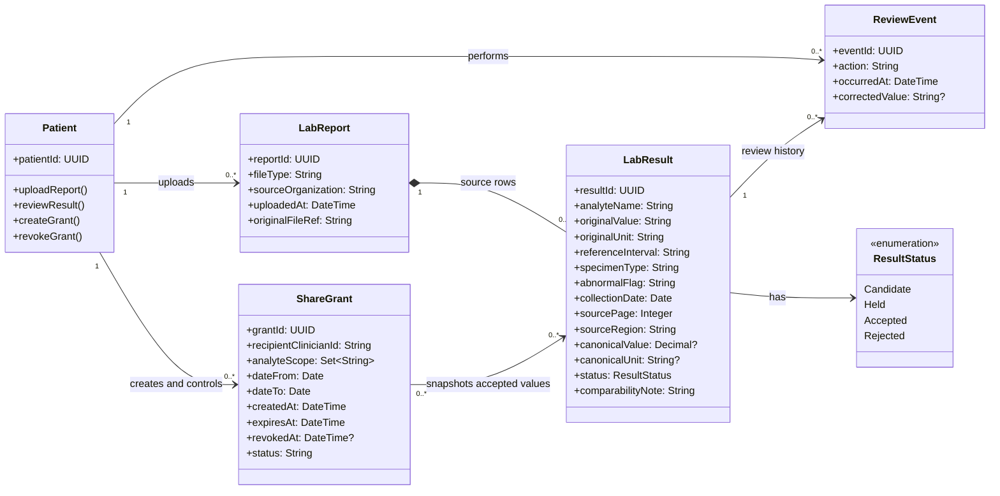

# LabTrail UML Draft

## System overview

LabTrail lets a patient collect laboratory reports from multiple providers, turn report rows into source-linked result candidates, and accept, correct, or reject each candidate. Accepted results appear in a longitudinal record with provenance and comparability context. The patient can create a scoped, expiring, revocable grant for a named clinician. LabTrail organizes and presents results; it does not interpret them.

## Classes

- **Patient** — The account holder who uploads reports, reviews results, and controls sharing.
- **LabReport** — An uploaded PDF or image retained as the source for extracted results.
- **LabResult** — One source-linked lab row, retaining its original value and unit alongside any normalized value and review status.
- **ShareGrant** — The patient's authorization to share a selected, immutable snapshot of accepted results with a named clinician for a limited time.
- **ReviewEvent** — A supporting audit record of a patient's accept, correct, or reject action, including when it occurred. This is included because a status field alone cannot preserve the required review history.

The clinician is represented by an identifier on `ShareGrant`, rather than a separate class; this draft assumes clinician identity is managed by an external authentication system.

## Class diagram

## Modeling notes

- A `LabResult` always points to its source report; unconvertible results retain their original value and unit while normalized fields may be empty.
- `ShareGrant` relates to an immutable snapshot, not a live view of `LabResult`. Later corrections or new results require a new grant; the scope and snapshot contents stay inside the encrypted bundle.
- The four initial candidate classes are `Patient`, `LabReport`, `LabResult`, and `ShareGrant`. `ReviewEvent` is an additional supporting class required to represent the patient's auditable review actions.
