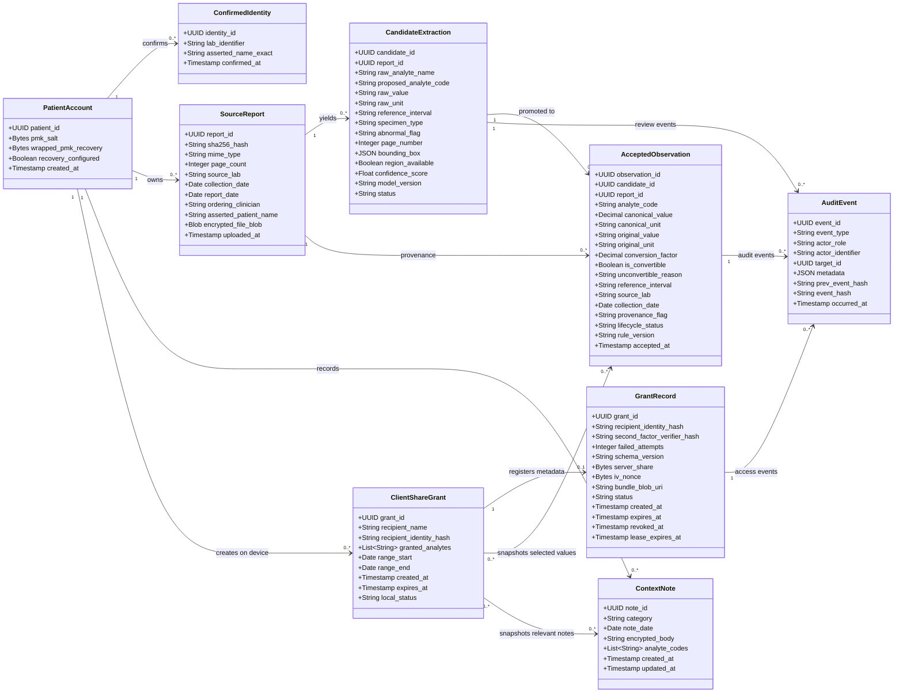

# LabTrail UML Draft

## System overview

LabTrail turns patient-uploaded reports into source-linked result candidates. The patient explicitly accepts, corrects, or rejects each candidate; only accepted observations appear on longitudinal timelines. Patients can add dated context notes and share an immutable, scoped, expiring bundle with a named clinician. LabTrail organizes information but does not interpret results.

## Class choices

- **PatientAccount** represents the patient and their local record/key setup. This refines the initial `Patient` candidate.
- **SourceReport** represents an uploaded source document. This refines `LabReport`.
- **CandidateExtraction** and **AcceptedObservation** separate extracted proposals from patient-verified record values. Together they refine the initial `LabResult` candidate.
- **ClientShareGrant** records the patient's local recipient and scope choices; **GrantRecord** is the corresponding minimal server-side authorization record. Together they refine `ShareGrant`.
- **ConfirmedIdentity**, **ContextNote**, and **AuditEvent** capture identity review, dated context, and auditable patient/recipient actions required by the workflow.

The clinician is represented by a recipient identifier, not a separate class, because identity and authentication are managed by an external system.

## Class diagram

## Modeling notes

- The first four noun candidates map to `PatientAccount`, `SourceReport`, the `CandidateExtraction`/`AcceptedObservation` pair, and the `ClientShareGrant`/`GrantRecord` pair.
- Candidate extraction preserves the reported value, unit, and source region. An accepted observation records patient-reviewed and normalized data; an unconvertible value retains its original representation.
- `ClientShareGrant` is patient-side and contains recipient and scope choices. It copies selected observations and relevant context into an immutable encrypted bundle. Corrections or new results require a new grant; the bundle is not a live link.
- `GrantRecord` is server-side and contains only authorization, expiry, and ciphertext/key-share metadata. It must not contain recipient display names, analyte scope, date range, or clinical values in plaintext.
- Sensitive patient-owned fields are encrypted before persistence in the hosted store. Audit metadata records actions and targets, not clinical values or share scope.
